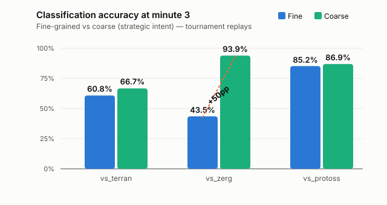
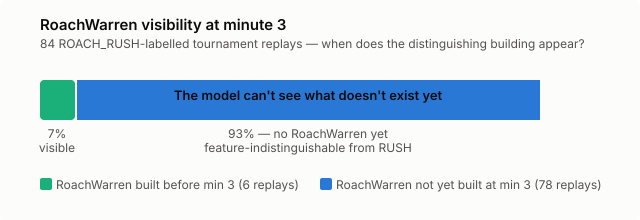

# Your Classifier Isn't Broken — Your Labels Are

Our ONNX strategy classifier had a problem. Against Zerg opponents at minute 3,
tournament-era accuracy was 43.5%. Less than a coin flip. The model was trained
on 148K replays. It worked fine against Protoss (85%) and recovered against Zerg
by minute 5 (55%). But at minute 3 — the earliest checkpoint where you'd want
strategic intelligence — it was useless against Zerg.

The dominant failure: 106 replays labelled ROACH_RUSH were classified as RUSH.
Two different fine-grained labels, both meaning "aggressive Zerg opener." Claude
and I spent a session digging into the data, and what we found reframed the
entire problem.

## The coarse accuracy reveal

The classifier outputs fine-grained predictions — ROACH_RUSH, RUSH, LING_BANE,
MACRO_ECONOMY, and so on. But these fine labels roll up into coarse categories
that capture strategic intent: AGGRESSIVE, TECH_AIR, GROUND, MACRO, TECH. Both
ROACH_RUSH and RUSH map to AGGRESSIVE.

When we measured coarse accuracy — "did the model get the strategic intent
right?" — the picture inverted:

vs_zerg jumped from 43.5% to 93.9%. A fifty percentage point lift. The model
wasn't confused about *what the Zerg player was doing* — it correctly identified
aggressive intent almost every time. It just couldn't tell you which flavour of
aggression, and the fine-grained labels punished it for that.

vs_terran showed a modest lift (+6pp). vs_protoss barely moved — those fine labels
are already distinguishable at minute 3 because the buildings are different enough.

## Why the labels are wrong at minute 3

The labelling rule for ROACH_RUSH is simple: if a RoachWarren appears before 5.5
minutes, the replay is labelled ROACH_RUSH. The label is assigned from the
full-game build order — it uses information the model doesn't have at minute 3.

We audited all 84 ROACH_RUSH tournament replays to check when the RoachWarren
actually appears:

93% of ROACH_RUSH replays have no RoachWarren at minute 3. The median timing is
3.6 minutes — after our checkpoint. At minute 3, a ROACH_RUSH game and a RUSH
game look identical in the feature space: aggressive spawning pool timing, no
distinguishing tech building, similar unit counts.

The model is being penalised for failing to distinguish things that are not yet
distinguishable.

## Phase-aware thresholds

Different game minutes have fundamentally different information budgets. At minute
3, scouting is limited and most tech buildings haven't been placed. By minute 5,
army composition is visible and tech choices are committed. Applying the same
accuracy threshold across all checkpoints conflates model quality with information
availability.

We defined per-minute expectations:

| Minute | Fine threshold | Coarse threshold | Why |
|--------|---------------|-----------------|-----|
| 3 | 45% | 65% | Limited scouting, many strategies indistinguishable |
| 4 | 55% | 80% | Tech choices becoming visible |
| 5 | 60% | 85% | Army composition clear, subtypes visible |

The classifier meets all of these. It was never broken — we were measuring the
wrong granularity.

## The real remaining gaps

With within-category confusions accounted for, the actual cross-category failures
become visible. BANSHEE_HARASS misclassified as BIO_TIMING (40 cases) — a genuine
confusion between Terran archetypes that share early production buildings.
MACRO_ECONOMY confused with PROXY in both directions (30 cases) — a real
separation problem. These are the failures worth investigating, and they were
buried under the ROACH_RUSH noise.

Coarse accuracy didn't fix the classifier. It revealed what the classifier was
already doing well and surfaced the failures that actually matter.
