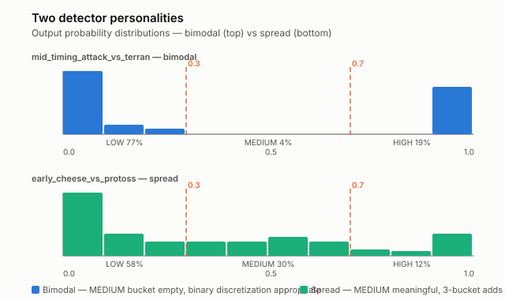

# Not All Detectors Are Binary

QuarkMind's Bayesian strategy tracker uses binary ONNX detectors — one per
strategic question ("is this a rush?", "is this air tech?"). Each detector
outputs a probability between 0.0 and 1.0, and we discretize that into
buckets for the CPT tables: LOW below 0.3, MEDIUM between 0.3 and 0.7,
HIGH above 0.7.

The thresholds were guesses. We ran all 23 detectors over the training corpus
(28K–77K samples per matchup) to see what the output distributions actually
look like.

## Two personalities

The detectors split cleanly into two groups:

**Bimodal detectors** (13 of 23) produce outputs clustered at the extremes —
near 0.0 for negatives, near 1.0 for positives, almost nothing in between.
These are the confident ones: `mid_timing_attack_vs_terran` puts 77% of
samples below 0.1 and 19% above 0.9. The MEDIUM bucket holds 4% — noise,
not signal.

**Spread detectors** (10 of 23) distribute outputs across the full range.
`early_cheese_vs_protoss` has 30% in MEDIUM. `early_rush_vs_zerg` splits
nearly evenly: 7% LOW, 47% MEDIUM, 46% HIGH. For these detectors, MEDIUM
genuinely means "uncertain" — a game state where the evidence doesn't commit
either way.

## The problem with one-size-fits-all

The 3-bucket discretization was designed for spread detectors. When you have
meaningful uncertainty in the middle, three states capture more information
than two. But for bimodal detectors, the MEDIUM bucket is empty — you're
adding a state to the Bayesian network that has no training data behind it.
The CPT entries for MEDIUM become noise rather than learned signal.

Eight detectors have MEDIUM populations below 5%. For
`mid_ground_heavy_vs_zerg` (99.2% LOW, 0.8% MEDIUM, 0.0% HIGH), the
three-bucket CPT is learning from 4 samples in the MEDIUM row. That's not
a prior — it's an accident.

## The fix

Per-detector discretization. Bimodal detectors get binary buckets (HIGH/LOW).
Spread detectors keep three (HIGH/MEDIUM/LOW). The detector manifest already
tracks enough statistics to classify this automatically — if the MEDIUM
population is below 5%, fall back to binary.

The guard was in the original spec. We just hadn't measured whether it would
fire. It fires for a third of the detectors.
