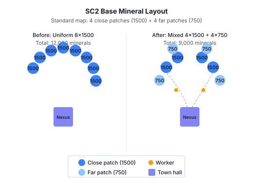
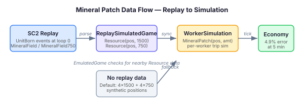

# Every Mineral Patch Is Not the Same

A standard SC2 base has eight mineral patches arranged in a semicircle around the town hall. If you're writing a game AI and you model all eight as identical — same starting minerals, same depletion curve — you're making an assumption that breaks before the five-minute mark. Four of those patches are close patches with 1,500 minerals. The other four are far patches with 750. The total per base is 9,000, not 12,000.

This matters because mineral income is the heartbeat of every SC2 strategy. A fast expand relies on workers saturating across two bases before the opponent pushes. An all-in sacrifices long-term income for immediate army value. If the economy model backing those decisions is wrong by 25% at the base level, every downstream decision — when to expand, when to push, how many production buildings to sustain — inherits that error.

## The flat mining problem

QuarkMind's `EmulatedGame` replaced its formula-based mining model with per-worker trip simulation a few days ago. Each `SimulatedWorker` picks a mineral patch, walks to it, mines for 46 game loops, carries 5 minerals back to the town hall, deposits, and repeats. Workers queue when a patch is occupied. The per-tick income emerges from the simulation rather than being calculated from a lookup table.

The simulation was more accurate than the formula — mineral collection rate error at five minutes dropped to 4.9% across 118 oracle replays. But every `MineralPatch` started at 1,500 minerals. Close patches, far patches, gold bases — all identical. That means the simulation gets the *rate* roughly right (workers move and mine at correct speed) but the *total available minerals* per base is inflated by a third.

For short games this barely registers. Income rate depends on worker count and trip time, not on remaining patch minerals. But in any game that runs past the early-to-mid transition — which is most of them — patches start depleting. Far patches deplete first because they hold half as much. Workers from depleted patches redistribute to remaining ones, increasing contention and reducing per-worker throughput. The depletion curve shapes when a player *must* expand, and getting it wrong by 3,000 minerals per base means the emulator thinks a single-base economy is viable longer than it actually is.

## What SC2 maps actually look like

Every competitive SC2 map follows the same convention. Each base has eight mineral patches in two tiers:

- **Close patches** (4 per base): 1,500 minerals. These are the patches nearest the town hall. Workers assigned to close patches have shorter trip times and are the primary income source.
- **Far patches** (4 per base): 750 minerals. These sit in an outer arc. Workers take longer per trip and the patches deplete first.

Gold bases (rich mineral fields) have the same initial amounts but workers carry 7 minerals per trip instead of 5 — a 40% throughput increase that makes gold expansions strategically valuable despite identical depletion curves.

The amounts come from the SC2 unit type names embedded in replay tracker events. A `MineralField` at a position carries 1,500; a `MineralField750` carries 750. The replay data has this information. The question was whether the emulator used it.

## Flowing map data into the simulation

The fix has two paths. When replay data is available — which is the case for all calibration and training — the `ReplayValidationHarness` extracts mineral patch `Resource` records from the ground truth at game start. Each `Resource` carries a position and an initial amount. When `EmulatedGame` registers a town hall, it searches for nearby resource records within a 12-unit radius and passes them to `WorkerSimulation`, which creates `MineralPatch` objects with actual map positions and amounts.

When no replay data is available — mock mode, standalone emulation — the default falls back to the standard SC2 distribution: 4 close patches at 1,500 and 4 far patches at 750, arranged in a synthetic semicircle. This is still more accurate than the old uniform model.

The code change is small. `MineralPatch` gains a constructor parameter for initial amount instead of hardcoding 1,500. `WorkerSimulation` gains an overload that accepts real patch data. `EmulatedGame` routes all town hall registrations through a single helper that checks for nearby map data first. None of the existing economy or playbook calibration tests needed updating — the per-tick income rate is unchanged; only the total available minerals per base shifts.

## Why calibration discipline matters

The mineral patch fix is individually minor. What makes it worth writing about is the pattern it represents.

Simulation-based AI systems have a fidelity problem that compounds silently. Each small inaccuracy — a flat mining rate, uniform patch amounts, a missing gas income model — is individually tolerable. None of them breaks a test. None of them produces an obviously wrong result. But they stack. The economy model feeds the strategy layer. The strategy layer feeds the tactical planner. The tactical planner decides which units to build, where to attack, when to expand. If the economy model is wrong, every decision downstream is being optimised against a fiction.

The discipline is unglamorous: parse the real data, calibrate against ground truth, measure the error, set regression thresholds, and don't let the baseline slide. QuarkMind's tracker-driven accuracy is now 100% for units, buildings, and upgrades. Mineral collection rate is within 5%. These numbers didn't happen by accident — they're the result of twenty-three calibration issues systematically closing gaps. The economy frontier is the last big piece, and it's where the emulator transitions from "good enough for unit counting" to "accurate enough for strategic reasoning."

A game AI that doesn't know when its patches deplete can't reason about expansion timing. One that thinks it has 12,000 minerals per base instead of 9,000 will underestimate how urgently it needs a natural. The fix is not a better algorithm — it's better data flowing into the algorithm that already exists.
