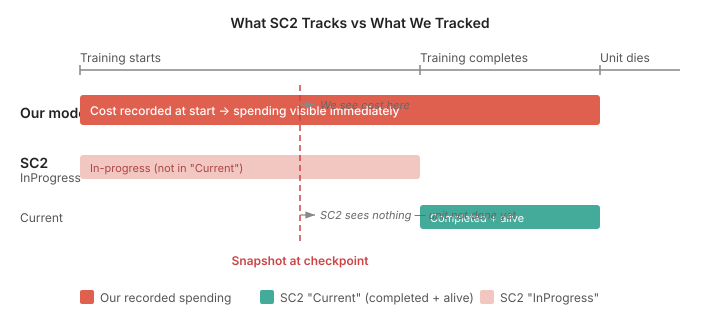

# Measuring the Right Thing at the Wrong Time

Spending tracking in the standalone EmulatedGame was 62% wrong. Army minerals, technology minerals, vespene — all overcounted by roughly the same factor across 118 professional StarCraft II replays. The error was too consistent to be a classification problem. Classification mistakes shift spending between categories; they don't inflate every category by the same amount.

The 1-minute checkpoint made it obvious. SC2's ground truth reported zero army spending and zero technology spending. We reported 14,200 minerals in army and 25,100 in technology. At one minute, there are no combat units and no tech buildings. Zero is the only correct answer.

Something was recording spending that shouldn't exist yet.

## Two fields, one concept, different clocks

Claude dug into the SC2 replay protocol and found that spending is tracked in two parallel sets of fields. `scoreValueMineralsUsedInProgressArmy` tracks minerals committed to units currently training. `scoreValueMineralsUsedCurrentArmy` tracks minerals invested in units that have completed training and are alive on the map.

We were comparing our model against "Current" — completed items only. But we were recording spending at the moment training started.

A Zealot that takes 27 seconds to warp in appears in our spending ledger the instant the Gateway begins. It doesn't appear in SC2's "Current" ledger until it materialises. At any snapshot, every unit or building under construction inflates our numbers but not the ground truth.

That's why the error grew with time. At one minute: very few things in production, small gap. By five minutes: dozens of units training and buildings constructing across 236 player runs, 65,000 minerals of phantom spending.

The fix was mechanical. Move `recordTrainSpending` and `recordResearchSpending` from the moment the order is placed to the completion callback. For buildings injected from replay ground truth, record spending only when the building transitions to complete.

## Overlords are supply, not army

The 1-minute data had a second signal. Even with correct timing, 14,200 minerals in army spending made no sense. At one minute the only non-worker units are Overlords.

SC2 classifies Overlords as economy spending. They provide supply — functionally identical to Pylons and Supply Depots, which are already economy buildings. Supply structures go to economy; supply units should too. We were routing them to army because `isWorker()` returned false and that was the only check.

Adding a `unitSupplyProvided(type) > 0` guard to the economy classification fixed it. Army spending at one minute dropped from 14,200 to zero.

## The result

| Field | Before | After |
|-------|--------|-------|
| mineralsUsedCurrentArmy | 62.5% | 10.4% |
| mineralsUsedCurrentEconomy | 10.3% | 4.7% |
| mineralsUsedCurrentTechnology | 63.2% | 23.9% |

The remaining technology gap came from 218 buildings mapping to UNKNOWN — warp-in units firing UnitInit events and being treated as buildings by the replay parser. Fixing the mappings and adding a `BUILDING_NAMES` guard eliminated the phantom buildings entirely.

## The thing worth remembering

When your model tracks "what has been ordered" and your ground truth tracks "what is completed and alive," you get a systematic overcount that looks like a logic bug but is a measurement mismatch. The accounting can be perfectly correct — adding costs on start, subtracting on death — and still diverge from ground truth by 60% because ground truth uses a different clock.

The fix isn't better accounting. It's matching the measurement point.
