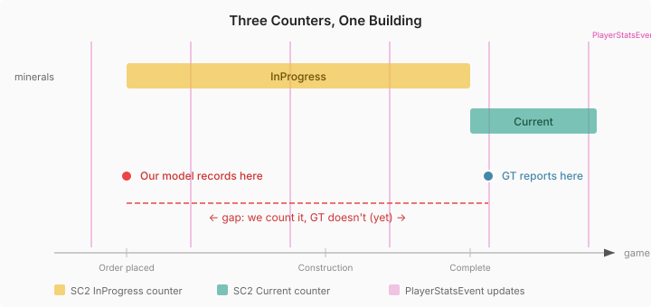

# The Floor You Can't Fix

After fixing the spending timing bug that dropped army MAPE from 62% to 10%, technology spending was still 24% off at the five-minute mark. The natural assumption was a classification error — some buildings counted as technology that SC2 counts differently. I ran seven hypothesis tests, each reclassifying different building groups: defensive structures to army, production buildings to army, Zerg-specific adjustments. Every single one made the MAPE worse.

The classification was already correct. The remaining 24% was not a code problem.

## Five categories, not three

Claude dug into Blizzard's `score.proto` — the protobuf definition behind the SC2 API — and found that SC2 internally uses five spending categories, not three:

| Category | What it covers |
|----------|---------------|
| none | No category defined — not tracked in any counter |
| army | Military units (not workers) |
| economy | Town halls, supply, gas, workers |
| technology | Structures that produce units or upgrades |
| upgrade | Individual research (Stimpack, WarpGate, weapons) |

The replay tracker events fold these to three: upgrade gets merged into technology, and "none" gets silently dropped from all counters. Defensive buildings — Photon Cannons, Bunkers, Spine Crawlers, Missile Turrets — likely have `CostCategory = none`. SC2 does not track their spending at all. They do not appear in army, economy, or technology totals.

This explains something the hypothesis tests showed: moving defensive buildings to army made accuracy *worse*. The correct treatment is to exclude them entirely — not to move them to a different bucket. They are genuinely untracked by SC2.

## The real gap: eventual consistency

But defensive buildings account for roughly 11,000 minerals of the 18,650-mineral gap. The other 7,650 comes from something more fundamental.

SC2 tracks spending through three parallel counters per category:

- **InProgress** — minerals committed to items under construction
- **Current** — minerals invested in completed, alive items
- **Lost** — minerals invested in items that have been destroyed

These counters update periodically via `PlayerStatsEvent`, which fires roughly every 160 game loops — about seven seconds of game time. Our emulator records spending per-tick, at the exact moment of building injection.

At any snapshot, buildings that completed since the last `PlayerStatsEvent` exist in our ledger but not in ground truth's "Current" counter. Their cost is still sitting in SC2's "InProgress" counter, waiting for the next event to move it over.

At the five-minute checkpoint across 236 player runs, ground truth reports roughly 26,000 minerals in InProgress technology — buildings under construction whose cost has not yet transferred to "Current." That is not an error in either system. It is two ledgers with different update frequencies, each correct on its own clock.

## Why this matters for training data

If you are building game AI from replay data — strategy classifiers, outcome predictors, economy models — spending accuracy has a structural floor from this timing mismatch. You cannot fix it with better code. The replay's spending counters are eventually consistent with the game state, not instantly consistent.

The practical options:

- **Accept the floor.** For most ML applications, 24% MAPE on technology spending is noise that washes out across thousands of replays. Unit counts and building counts are exact. Spending is approximate.
- **Use InProgress + Current as the reference**, not Current alone. This gives total active spending regardless of completion status — closer to what the player has actually committed. The downside: you lose the distinction between "things that exist" and "things being built."
- **Match your recording point to the event cadence.** Instead of recording per-tick, accumulate spending changes and compare only at ticks where a `PlayerStatsEvent` fired. This eliminates the timing gap but reduces your measurement resolution to ~7-second intervals.

None of these are wrong. The choice depends on what you are measuring and why.

## The general pattern

Game APIs report state through periodic snapshots, not continuous streams. Scores, resources, unit counts, and spending all update on different schedules. A physics engine that produces correct values per-tick will still disagree with ground truth that updates every 160 loops — and the disagreement is not a bug in either system.

When the accuracy curve flattens and no code change moves it, check whether you are comparing two clocks. The measurement might be right. The synchronisation point might be wrong. Or there might be nothing wrong at all — just two systems with different temporal resolution, each reporting honestly from where they stand.
