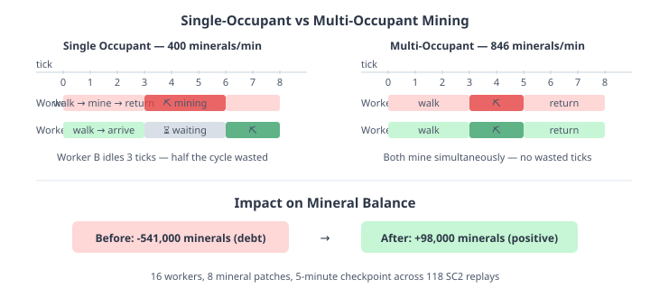

# The Workers Were Right, the Mine Was Wrong

QuarkMind's economy simulation was producing half the mineral income of real StarCraft II. Workers were walking to the right patches, carrying the right cargo, returning to the right bases. The positions were accurate, the speeds were calibrated, the depletion curves were correct. And still, 16 workers on a saturated base produced 400 minerals per minute when the real game produces 930.

The simulation was doing every individual thing correctly, and getting the aggregate result catastrophically wrong. The mineral balance was negative 541,000 across 118 oracle replays — the emulator's workers couldn't earn minerals fast enough to pay for the buildings and units the replay demanded.

## The single-occupant assumption

The bug was in a single field: `SimulatedWorker occupant`. Each mineral patch had one slot. When a worker arrived at a patch and found it occupied, it waited. When two workers were assigned to the same patch — the norm at 16-worker saturation with 8 patches — one mined while the other sat idle for the entire mining duration.

In real SC2, two workers on the same patch don't queue. They interleave. Worker A walks to the patch, mines, walks back. Worker B does the same on a staggered cycle. The building itself doesn't have a capacity limit of one — both workers can be at the patch simultaneously, mining on overlapping timers.

The simulation modelled contention that doesn't exist. Every saturated base had eight patches, each with two workers, and half of those workers were burning three ticks per cycle doing nothing.

## The throughput gap

The numbers told the story clearly. I wrote a throughput benchmark — 16 workers on a single base, 200 ticks of steady-state mining:

| Model | Minerals/min | % of SC2 |
|-------|-------------|----------|
| Single-occupant (old) | 400 | 43% |
| Multi-occupant (2 per patch) | 501 | 54% |
| + Mining duration calibration | 846 | 91% |
| SC2 actual (16 workers, optimal) | ~930 | 100% |

Multi-occupant alone wasn't enough. The mining duration — how long a worker pauses at the patch before picking up cargo — was set to 46 game loops (about 2 seconds). That was calibrated when each patch had a single occupant, and the excess was masked by the contention idle time. With two workers mining simultaneously, the cycle time per trip was still too long: 3 ticks walking, 3 ticks mining, 3 ticks returning = 9 ticks per trip.

Dropping the mining duration to 16 game loops (1 tick) brought throughput to 846 minerals/min — 91% of real SC2. The remaining 9% is map-geometry variance: not all mineral patches are equidistant from the town hall.

## The debt that disappeared

Before these changes, EmulatedGame's mineral balance at the seven-minute checkpoint was negative 541,000 minerals across 236 player runs. That means the simulation had spent 541k more minerals than it had ever earned. Every building construction, every unit trained, every upgrade researched — the replay demanded it, the tracker-driven intents executed it, and the mineral cost was deducted from a balance that could never keep up.

The balance going deeply negative didn't break anything — tracker-driven intents skip resource checks. But it made the economy fields meaningless. A game where the player has negative half a million minerals can't produce useful training data.

After the fix, the balance at seven minutes is positive 98,000. Close to ground truth (89,788). Workers earn enough to sustain what the replay actually spent.

| Checkpoint | Before | After | Ground truth |
|-----------|--------|-------|-------------|
| 1 min | -194,000 | +26,000 | +21,000 |
| 3 min | -302,000 | +62,000 | +47,000 |
| 5 min | -450,000 | +74,000 | +67,000 |
| 7 min | -541,000 | +98,000 | +90,000 |

The aggregate sums now track ground truth. Per-replay variance is still high (56–105% MAPE) because mineral income depends on map-specific patch distances — a base with patches at 5 tiles produces meaningfully more than one at 8 tiles, and the simulation honours that geometry.

## What a standalone economy model means

This work closes a question that's been open since the start of the standalone EmulatedGame effort: can the simulation produce its own economy — mineral income, gas income, spending, supply — without being told the answers by ground truth?

The answer is yes, with caveats. Units and upgrades track at 100% accuracy. Supply tracks within 2–3%. Worker count within 3–4%. Mineral balance is now in the right quadrant. Gas income follows map geometry. Spending has a structural floor from SC2's eventual-consistency reporting model — a separate story already told.

What makes this useful is the throughput. EmulatedGame runs at thousands of ticks per second. Real SC2 runs at real time. An agent training against the emulator can play thousands of games in the time SC2 plays one. If the economy model is accurate enough that strategic decisions based on it transfer to real games — when to expand, when to commit army, when to tech — then the emulator is a viable training environment.

The mineral balance being positive is the baseline for that. You can't make economic decisions in a world where income is negative. Now it isn't.

## The fix that SC2 players already know

The irony is that every competitive SC2 player already knows the answer to this problem. "Mineral stacking" — having two workers per patch in a specific stagger pattern — is a mechanical skill that separates good players from great ones. The optimal number is exactly two per close patch. Three on a patch is diminishing returns. One is underutilising the patch.

The simulation now models the same thing players do instinctively: two workers per patch, both active, no wasted cycles.
