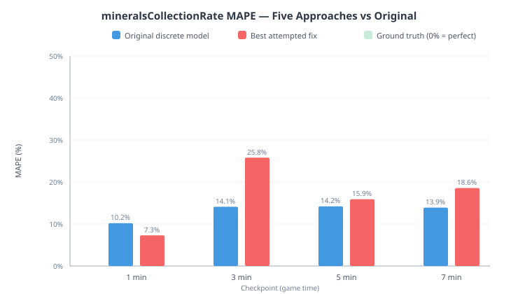
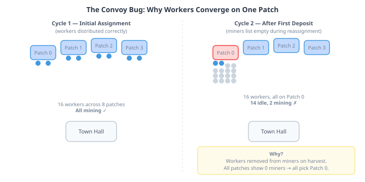

# The Bug That Held the Roof Up

QuarkMind's mineral collection rate was 10–14% off ground truth. After fixing the single-occupant bug and calibrating mining durations, 10–14% felt like the next problem to solve. Two separate issues proposed specific fixes. I tried five approaches. Every one made accuracy worse.

The model was already at its ceiling. The 10–14% wasn't a bug in the mining cycle. It was being held in place by a bug somewhere else entirely — one that happened to compensate for errors it had nothing to do with.

## The tick quantisation hypothesis

The discrete mining model updates worker positions once per tick — 22 game loops, roughly one second of game time. Workers walk to a mineral patch, mine for one tick, walk back, deposit. The round trip at a typical patch distance of 6.0 takes exactly 5 ticks regardless of actual distance, because any distance between 4.4 and 8.2 quantises to the same 2-tick walk. Close patches and far patches produce identical income.

In real SC2, workers move every game loop. A close patch at distance 5.0 gives a 3.3-tick trip. A far patch at 7.0 gives a 4.3-tick trip. The quantisation erases this variation, turning a smooth income curve into a step function. That looked like the obvious fix: replace the integer-tick walk simulation with fractional trip timing based on actual distance.

Claude and I tried five approaches, each targeting a different angle:

| Approach | 1-min MAPE | 3-min | 5-min | 7-min |
|----------|-----------|-------|-------|-------|
| Original discrete model | 10.2% | 14.1% | 14.2% | 13.9% |
| Formula-based rates (like gas) | 21.9% | 15.8% | 17.2% | 25.1% |
| Fractional trip (distance-based) | 46.0% | 18.5% | 15.4% | 24.5% |
| Convoy fix + contention | 12.1% | 16.9% | 33.9% | 37.3% |
| Convoy fix, no contention | 7.4% | 25.8% | 15.9% | 18.6% |

The formula approach was the most principled — the same technique that already works for gas income, using calibrated per-worker rates from 118 oracle replays. It made every checkpoint worse. The fractional trip approach produced correct per-worker rates at each distance but over-produced because the raw physics trip time is shorter than what real SC2 delivers (SC2 workers accelerate, decelerate, navigate obstacles, and animate). And every attempted calibration factor that fixed one checkpoint broke another.

The pattern was consistent: any uniform rate change helped early checkpoints and hurt late ones, or vice versa. The model over-produces at 1-minute and under-produces at 3–7 minutes. No single mining rate can fix both directions simultaneously.

## The convoy nobody noticed

While tracing why the original model under-produced at later checkpoints, I found the real story. The model has a reassignment bug: when a worker deposits minerals and gets sent to its next patch, the code picks the "nearest patch with available mining slots." But the available-slot check reads the `miners` list, and workers aren't added to that list until they physically arrive at the patch — not when they're assigned.

After the first deposit cycle, all workers return to base at the same tick. Each calls `assignToNearestPatch`. All patches show zero miners (the list was cleared during harvest). The first patch in the list wins every tie. All 16 workers get assigned to Patch 0. Only two can mine simultaneously. Fourteen sit idle, waiting for their turn at a single mineral patch while seven others stand empty.

This is the bug. It halves throughput at saturated bases and gets worse as worker count grows. And it has been present since the mining model was written.

## The load-bearing part

Here is where it gets interesting. When I fixed the convoy — workers return to their previously assigned patch instead of being reassigned — the 1-minute MAPE dropped from 10.2% to 7.4%. Workers were finally distributed correctly, mining at full speed from the start. A clear improvement.

But 3-minute MAPE jumped from 14.1% to 25.8%. The fix exposed the truth: the simulation's per-worker mining rate is slightly too fast. The convoy was suppressing income at later checkpoints by keeping most workers idle. Remove the suppression, and the over-production becomes visible.

The convoy was a load-bearing bug. It was wrong — workers should not converge on a single patch. But the wrongness produced a side effect that happened to compensate for a different error: the discrete model's mining rate being slightly faster than SC2's actual worker throughput. Fix the bug, expose the compensation, and net accuracy drops.

## The supply hypothesis that wasn't

The same session surfaced a parallel investigation. SC2 reports `foodUsed` — the supply consumed by your army. The emulator was 2–6% above ground truth at most checkpoints. A reasonable hypothesis: maybe the emulator counts supply at training start (when a unit enters the production queue), while SC2 counts it at completion (when the unit actually spawns).

I deferred the supply assignment from `startTraining` to the completion callback. The result was immediate and unambiguous: MAPE at 3-minute went from 2.5% to 8.3%. The change made things worse because the hypothesis was backwards. SC2 *does* count supply at training start — it reserves supply the moment you click the build button, not when the unit pops out. The emulator had the right semantics all along. The 2–6% gap was driven by the emulator having slightly more workers than ground truth, not by supply timing.

Two investigations in one session, the same conclusion: the model was more correct than the theory.

## What simulation engineers should take from this

This pattern is not specific to game AI or StarCraft. It appears in any system where a simulation is validated against ground truth:

**Accuracy can be load-bearing.** When a simulation has multiple interacting subsystems, errors in one can compensate for errors in another. The aggregate accuracy is better than either subsystem deserves. Fixing one error exposes the other. The net effect is a regression, even though each individual fix is correct.

**The direction test.** If improving a subsystem makes accuracy worse, the subsystem was compensating for something else. Before adding calibration factors or reverting the fix, find the *other* error. In our case: the convoy bug compensated for the mining rate being too fast. The real fix isn't to keep the convoy — it's to also fix the mining rate. We didn't do that this session because the mining rate error is driven by factors outside the mining model (gas transition timing, SC2's rate reporting cadence, worker count drift), each of which is a separate investigation.

**Validate hypotheses against data before implementing.** The supply timing hypothesis seemed so reasonable that it barely warranted testing — of course supply should track completion, not reservation. Five minutes of baseline measurement proved it wrong. In simulation work, "obviously correct" changes deserve the same measurement discipline as speculative ones.

The EmulatedGame's mineral collection rate sits at 10–14% MAPE. That number is the ceiling for the discrete mining model with its current surrounding systems. Reducing it requires fixing the gas transition timing, the SC2 rate reporting window match, and the worker count drift — three separate investigations, none of which involve the mining cycle at all. The mining model is done. The accuracy boundary is elsewhere.
