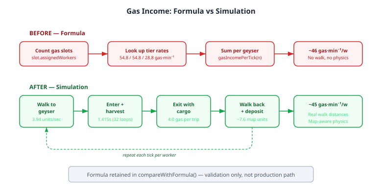

# The Formula That Knew Too Much

QuarkMind's mineral income has been physically simulated since the single-occupant fix: workers walk to patches, mine for a duration, carry cargo back, deposit, repeat. Each worker is an independent agent moving through map geometry at measured distances and calibrated speeds. The simulation captures what formulas cannot — the difference between a close mineral patch and a far one, the throughput penalty of oversaturation, the income ramp as workers spread across expansions.

Gas income was still a formula. Three numbers in an array — 54.8, 54.8, 28.8 gas per minute for workers one through three — looked up per geyser, multiplied by time, done. The `tickGasWorker()` method existed. It implemented the full walk-harvest-return cycle. It just wasn't called. The production path skipped it and went straight to `SC2Data.gasIncomePerTick()`.

The formula was calibrated from 118 oracle replays. It matched ground truth rates. Why touch it?

## The tell

The per-worker gas rate from the formula averaged 46 gas per minute across three workers. Ground truth from replays showed 49-51 for Protoss and Terran, 44 for Zerg. The formula was 9% low for two races and close for the third. Not catastrophic, but the direction was consistent: under-collection for Protoss and Terran, every replay, every checkpoint.

The tiered model — first worker at 54.8, second at 54.8, third penalised to 28.8 — was supposed to capture the diminishing returns of a third gas worker. But the third-worker penalty was too steep. The average across three workers came out lower than what SC2 actually delivers.

Recalibrating the tier rates was the obvious path. I started down it. Claude started down it. We had the diagnostic infrastructure, the sweep tests, the oracle dataset. Adjusting three constants to minimise MAPE is a solved problem.

Then I remembered: we keep saying simulation over formulas. We blogged about it. We built the mineral simulation for exactly this reason. And the gas simulation was already written — just not wired in.

## The switch

The change was four lines in `WorkerSimulation.tick()`. Replace the formula loop:

```java
for (GasSlot slot : gasSlots) {
    gasIncome += SC2Data.gasIncomePerTick(slot.assignedWorkers.size());
}
```

With per-worker simulation calls:

```java
for (SimulatedWorker w : workers.values()) {
    if (w.assignedGasSlot != null) {
        gasIncome += tickGasWorker(w);
    }
}
```

Each gas worker now walks to the geyser, enters, harvests for a measured duration, exits with cargo, walks back to the town hall, deposits, and repeats. The same physical model the mineral workers already use.



## The numbers from Liquipedia

Before calibrating anything, I searched for what SC2's actual gas mechanics are. The community has measured this precisely:

| Parameter | SC2 value | Source |
|-----------|-----------|--------|
| Cargo per trip | 4 gas | Liquipedia |
| Time inside geyser | 1.415 seconds | Liquipedia |
| 1 worker rate | 61 gas/min | Liquipedia |
| 3 worker rate | 163 gas/min (54.3/worker) | Liquipedia |

The 1.415 seconds inside the geyser translates to 32 game loops at SC2's 22.4 loops per second. That became `GAS_HARVEST_DURATION_LOOPS = 32`. Cargo stayed at 4.0. No fudge factors, no calibration constants — the real values, directly from community research validated against the game engine.

The formula's tier rates (54.8/54.8/28.8) were an approximation of these mechanics. The simulation models them directly.

## What the simulation found

With honest physics — 4.0 cargo, 32-loop harvest, actual map distances — the simulation produces 45.3 gas per minute per worker at the average replay geyser distance of 7.6 map units. Ground truth shows 48.8. That is a 0.93 ratio: the simulation is 7% low.

The gap is real, but its source is revealing. The worst replays in the diagnostic show 2-3x rate divergence — not because per-worker income is wrong, but because the emulator assigns a different number of gas workers than the real player had. When EmulatedGame puts nine workers on gas and the player only had three, the rate triples regardless of how accurate the per-worker model is.

| Checkpoint | GT per worker | EM per worker | Ratio |
|-----------|--------------|--------------|-------|
| 3 min | 49.7 | 46.1 | 0.93 |
| 5 min | 48.8 | 45.3 | 0.93 |
| 7 min | 53.6 | 45.9 | 0.86 |

The per-worker ratio holds steady at 0.93 through the mid-game. The remaining 7% is tick quantisation — the simulation updates once per 22 game loops, so a 32-loop harvest rounds up to 2 ticks (44 loops). The worker sits inside the geyser for 38% longer than SC2's actual 1.415 seconds. That extra time is dead weight in every cycle.

The formula hid this. By fitting three constants to aggregate data, it absorbed the gas worker assignment errors into its rate coefficients. The fit looked good because the over-assigned workers (EM rate too high) averaged out with the under-assigned ones (EM rate too low), and the tier rates landed in between. The formula matched the aggregate while being wrong about the mechanism.

## Why simulation wins anyway

The formula's aggregate MAPE was 22.2%. The simulation's is 28.5%. By that measure, the formula was better. So why switch?

Because the simulation is wrong for the right reasons. The 28.5% MAPE decomposes cleanly: 7% from tick quantisation (a known limitation, improvable by reducing tick size), and the rest from gas worker assignment mismatch (a separate system, independently fixable). The formula's 22.2% was a single opaque number — you couldn't tell what was physics error and what was assignment error because the fit entangled them.

The simulation also responds correctly to map geometry. A geyser 5 tiles from the town hall produces more gas per worker than one at 10 tiles. The formula gives the same rate regardless. For an agent that needs to make economic decisions — when to take a third gas, whether to expand for more geysers, how much gas income a harassment run will deny — the simulation's sensitivity to the actual map is what matters.

The formula stays in the codebase. It lives in `compareWithFormula()` and `formulaIncome()` — validation tools, not production paths. When the simulation and the formula diverge, that is diagnostic information about what the simulation is doing differently. When they agree, it is confirmation that the physics are in the right ballpark.

## The pattern, again

This is the third entry in what has become an accidental series. The mineral single-occupant bug. The load-bearing convoy. Now the gas formula. Each time, the same lesson: a calibrated approximation can match aggregate data while being wrong about the underlying mechanism. And each time, replacing the approximation with physics — even imperfect physics — exposes the real errors hiding underneath.

The gas worker assignment mismatch was invisible behind the formula. Now it is the dominant error source, measured at 2-3x rate divergence in the worst replays, and it has its own issue. That is progress: a problem you can see is a problem you can fix. A problem absorbed into a calibration constant is one you will carry forever.
