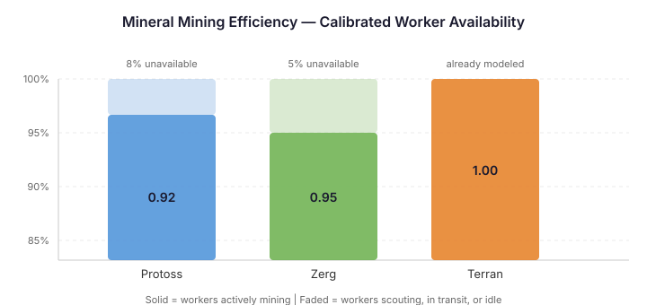

# The Workers Who Weren't There

*Continues the [100% accuracy series](2026-11-08-mdp01-every-fix-reveals-the-next-assumption.md).*

QuarkMind's mineral income is physically simulated. Each worker is an independent agent. It walks to a mineral patch, occupies a slot, mines for a calibrated duration, picks up cargo, walks back to the town hall, deposits, and returns for the next trip. The simulation captures real map geometry — close patches earn more than far patches, oversaturated bases penalise throughput, and expansion worker transfers happen at the right moment. Every worker mines every tick.

That last sentence is the problem.

## The gap that shouldn't exist

The gas formula was the previous entry's subject — a tiered approximation that absorbed errors into its rate constants. Switching to physical simulation exposed the real error source (gas worker assignment) and left per-worker accuracy at 93%. Mineral income was already physically simulated. No formula to replace. The physics should have been right.

mineralsCurrent MAPE at the seven-minute checkpoint was 79.7%. The emulator was over-earning. Consistently, across all three races, the simulated workers brought home more minerals than real players accumulated in the same number of game loops. Per-worker mineral income in the simulation ran 5-10% above ground truth across 118 replays.

The simulation wasn't wrong about the physics. It was wrong about the players.

## What real players do with their workers

A StarCraft player with 16 workers on minerals doesn't have 16 workers mining. At any given moment, two or three of them are doing something else:

- A Probe scouting the enemy base in the first two minutes — gone for 30 to 90 seconds of mining time
- An SCV walking to a construction site, building a Supply Depot, walking back
- Workers in transit between bases after an expansion, briefly idle at both ends
- A worker sent to a proxy location or a defensive position and forgotten
- Workers that finished a task and sit idle for a few seconds before being reassigned

The simulation can't model these behaviours directly. It doesn't know when a player will send a scout, or how long a worker will sit idle after being pulled for a building. But it can measure the aggregate effect: what fraction of workers are actually mining at any given time?

## Calibrating what you can't see

The approach was a per-race mining efficiency factor — a scalar on mineral income that represents the fraction of workers actively mining. Not a formula replacement. An availability factor.

The calibration swept 16 candidate values from 0.85 to 1.00 against 118 oracle replays, measuring mineralsCurrent MAPE at the five-minute and seven-minute checkpoints. A linear approximation made this practical: run each replay once, record the cumulative mineral income at each checkpoint, then compute the adjusted MAPE for every candidate value algebraically. No need to re-run 118 replays sixteen times.

The trick works because the efficiency factor is a simple scalar on income. For a candidate factor *f*, the adjusted mineral balance is the original balance minus (1 − *f*) times the cumulative mineral income. The spending trajectory changes slightly — with less income, some units become unaffordable — but across a range of 0.85 to 1.00, the spending impact is negligible. The approximation and the exact re-run converge to the same optimal value.

## What the numbers found

| Race | Optimal factor | MAPE before | MAPE after | What drives it |
|------|---------------|-------------|------------|----------------|
| Protoss | 0.92 | 141.4% | 88.1% | Most scouting. Probes walk to warp-in locations, scout enemy bases, build proxy Pylons |
| Zerg | 0.95 | 58.9% | 47.0% | Moderate. Distributed base layout means shorter transit, but Drones morph into buildings |
| Terran | 1.00 | 65.2% | 65.2% | No improvement. Building pause fix already models SCV downtime during construction |

The Terran result is the most informative. When building construction was fixed in an earlier entry — pausing the SCV from mining for the full build duration — it absorbed the dominant source of Terran worker downtime. The efficiency sweep confirmed this: every factor below 1.0 made Terran's MAPE worse, not better. The simulation already accounts for the thing that makes Terran workers unavailable.

Protoss at 0.92 means roughly one in twelve workers isn't mining at any given time. Three workers out of a 36-worker economy in the mid-game. That matches what you'd expect from a race that sends an early Probe scout, warps in buildings at remote locations, and occasionally sends a worker to hold a tower or proxy a Pylon.

Zerg at 0.95 sits between the other two. Zerg workers are consumed when they build — a Drone morphs into the building and is gone. But the simulation already handles that via the building intent system. The remaining 5% is transit time between distributed Hatcheries and idle time during queen inject cycles.

## The deeper pattern

The MAPE values are still high. Mineral economy accuracy has structural issues beyond worker availability — spending model alignment, PlayerStatsEvent update cadence, cumulative drift. The efficiency factor doesn't fix those. What it fixes is the 5-10% per-worker over-earning that was amplifying every other error.

This is the pattern that keeps repeating in this series. You build accurate physics. The aggregate numbers don't match. The temptation is to tune the physics — adjust mining duration, fudge cargo amounts, add a rate multiplier. But the gap isn't in the physics. It's in the human behaviours the physics can't model: the scouts, the idle workers, the construction walks. The efficiency factor is not a fudge. It's an honest acknowledgment of the boundary between what the simulation sees and what it can't.

A simulation that faithfully models sixteen workers mining will produce the income of sixteen workers mining. The player only has thirteen actually at the patches. The fix isn't to make each worker mine less accurately — it's to tell the simulation how many workers are really there.
