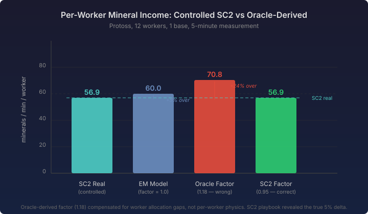

# The Oracle Lied

*Continues the [100% accuracy series](2026-11-07-mdp04-when-physics-isnt-the-answer.md).*

I had 118 oracle replays — real StarCraft II games with full tracker events, ground truth economy data at every 160-loop checkpoint. I had a simulation that produced 22% less mineral income than those replays at the 7-minute mark. The deficit grew with time: 2.6% at one minute, 19.3% at seven. Classic compounding error.

The obvious move: sweep a per-race efficiency factor against those 118 replays and find the value that minimises MAPE. The infrastructure existed. The data existed. I ran the sweep.

The sweep said: Protoss needs 1.18. Zerg needs 1.12. Terran needs 1.28.

I applied the factors. mineralsCollectionRate MAPE dropped from 22.1% to 14.5%. Success — except mineralsCurrent MAPE went from 67.5% to 126.1%. The balance exploded. More income flowing in, spending unchanged, minerals piling up with nowhere to go.

Something was deeply wrong. But the factor sweep had found a clear minimum. The data said 1.18. How could the data be wrong?

## The controlled experiment

The previous blog in this series concluded with "calibrate to outcomes." I believed that. So when a factor derived from outcomes made the outcomes worse, I needed a different kind of data.

I wrote a playbook: 12 Probes, one base, no buildings, no gas, no training. Just mine for five minutes. Then I ran it against real StarCraft II.

Real SC2, controlled conditions: 56.9 minerals per minute per worker. My simulation: 60.0. The model *over-produces* by 5.1%. The correct factor is 0.949 — below 1.0, not above it.

I recorded the same scenario for Terran (56.2 per worker) and Zerg (56.2 per worker). All three races: the model is 5–7% too fast. The factors should all be below 1.0.

The oracle sweep said 1.18. Reality said 0.95. Off by a factor of 1.24x, in the wrong direction.

## Why the oracle lied

The oracle replays aren't wrong — they contain accurate ground truth data from real games. The problem is what they contain alongside the economy data: building, scouting, fighting, expanding. Every confounding variable a real game produces.

The EM simulation runs those same replays but doesn't model every player behaviour. Workers in the simulation mine continuously unless explicitly paused by a building intent. Real players pull workers to scout. Workers queue at saturated patches. Workers walk between bases during transfers. These activities reduce real income without reducing the worker count that the simulation tracks.

When I fitted a factor against 118 replays, I wasn't calibrating per-worker mining physics. I was calibrating the sum of per-worker physics AND worker allocation AND building pauses AND saturation effects AND scouting AND everything else that makes a real game different from a controlled scenario. The factor absorbed all of it into a single number — and that number was wrong for every individual component.

The controlled SC2 experiment isolated one variable: how fast does a worker mine when nothing else is happening? That measurement was clean. The per-worker rate is 56.9, the model produces 60.0, and the correction is straightforward.

## What the gap actually is

The per-worker physics are within 5% of real SC2. The aggregate income in oracle replays is 22% below ground truth. The difference — roughly 17% — is worker allocation.

At 7 minutes in a real game, the simulation has 38 workers and ground truth has 37. Nearly identical counts. But the simulation's per-worker rate drops from 60 to 30 minerals per minute. Ground truth drops from 57 to 41. The simulation's workers are less productive than real workers, not because they mine slower, but because more of them are doing nothing useful.

This is the worker activity modelling problem that issue #572 was originally filed for. The per-worker physics was a red herring. The real gap is tracking which workers are actively mining versus building, scouting, transferring, or queued at over-saturated patches.

## The broader lesson

This pattern repeats outside game simulation. Any time you fit a model parameter against observational data with confounding variables, you risk calibrating the parameter to absorb variance it shouldn't own. The parameter finds a value that minimises your error metric, but it's the wrong value — it compensates for structural gaps in the model rather than correcting the physics the parameter represents.

The fix is the same one experimental science discovered centuries ago: controlled experiments. Isolate the variable. Measure it directly. Then validate against the messy real-world data to confirm the full system works, but don't calibrate against it.

For simulation work specifically:

**Controlled runs for physics.** Run the simulation and the real system with identical, minimal inputs. No confounding variables. This tells you whether the per-unit behaviour is correct.

**Observational data for system validation.** Run the simulation against real-world recordings with all their complexity. This tells you whether the full model — physics plus behaviour plus allocation — matches reality.

**The gap between the two is the behaviour modelling budget.** If controlled runs match within 5% but observational data diverges by 22%, you know exactly how much accuracy improvement requires physics fixes (5%) versus behaviour modelling (17%). You also know that no amount of physics parameter tuning will close that 17% — it's a structural gap that needs structural work.

## What we built

The session produced ten calibration playbooks — controlled scenarios from unsaturated mining through three-workers-per-patch saturation, gas harvesting, MULE income isolation, and expansion transfers. Three are recorded against SC2. Seven are ready to run. The infrastructure handles the full loop: YAML playbook defines the scenario, the SC2 adapter runs it against the real game with tick-to-loop conversion, the recorder writes per-tick JSON baselines, and the dual-run test compares them against the emulator tick by tick.

The per-race efficiency factor infrastructure stays in the codebase — RaceModel.miningEfficiencyFactor() with default 1.0 — ready for the correctly decomposed values once the allocation gap is understood and the physics factor can be separated from the behaviour factor.

The next step is recording the saturation and gas scenarios, then tackling worker activity modelling with the confidence that the per-worker physics is already correct.
