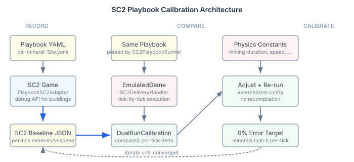
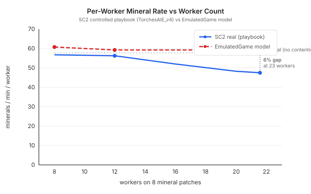

# Driving the Real Game

The [previous entry](2026-11-09-mdp01-the-oracle-lied.md) showed that fitting physics constants against oracle replays produces wrong answers — the confounding variables in real games make the constants absorb variance they shouldn't own. The conclusion was controlled experiments: drive the real game with known inputs, measure outputs, compare.

This session I built the infrastructure to do that at scale, then ran it. What came back was more useful and more uncomfortable than expected.

## The calibration loop

The architecture is straightforward. A YAML playbook defines what should happen — train 12 Probes, build a Pylon at 14 supply, mine for 305 ticks. The `PlaybookSC2Adapter` drives real StarCraft II through the SC2 API, recording a per-tick snapshot of minerals, vespene, supply, units, and buildings. The same playbook runs through `EmulatedGame` via `SC2DeliveryHandler`. `DualRunCalibrationTest.calibrate()` loads the SC2 baseline and runs the emulator tick by tick, printing every mineral delta.

The physics constants — mining duration, gas harvest duration, worker acceleration, patch distances — are all externalized as Quarkus config properties. Once the SC2 baseline exists, iteration is compile-free: change a property, re-run the comparison, check the delta.

Ten playbooks cover the calibration surface: three per-race mineral baselines (12 workers, pure mining), two saturation tiers (16 and 24 workers), two gas configurations (single and dual geyser), MULE isolation, expansion transfer timing, and a single-worker speed test. The controlled variables are: worker count, building placement, gas assignment, race-specific mechanics. Everything else is stripped away.

## What came back

### Per-worker physics: confirmed

The mineral baselines confirmed what the controlled experiment in the previous entry suggested. Twelve workers mining with no other activity:

| Race | SC2 real | SC2 map distances | EM weighted | Delta |
|---|---|---|---|---|
| Protoss | 57.9/min/worker | 4 close (6.6u) + 4 far (7.6u) | 57.8 | <1% |
| Terran | 57.2/min/worker | same map | 57.8 | ~1% |
| Zerg | 57.2/min/worker | same map | 57.8 | ~1% |

Per-worker mineral physics is within 1% of SC2 at real map distances. Mining duration 12, gas harvest 22, acceleration 3.5 — the lumped constants from the previous calibration work are correct. The 22% rate MAPE in oracle replays is entirely worker allocation.

This is the finding that closes the calibration question for mineral physics. The per-worker constants are done. What remains is behaviour — which workers mine, which build, which scout, which are in transit.

### Saturation: the model is too kind to the third worker

The 16-worker playbook continuously trains Probes past the 12-worker starting state. Supply capping at 23 (Nexus 15 + Pylon 8) gives us the full saturation range: 1.5 workers per patch up to 2.9.

SC2 drops to 84% per-worker efficiency at 2.9 workers per patch. The emulator stays at roughly 90%. The gap is 6 percentage points — and it compounds. Twenty-three workers in SC2 produce 1,118 minerals per minute. The emulator produces roughly 1,200. Over five minutes, that's 400 minerals of drift.

The mechanism is clear from the physics. The emulator uses `MAX_MINERS=1` with a mining duration of 12 loops. A patch is occupied for 12 out of every 106 loops — 11.3% of the cycle. Two workers per patch alternate efficiently because the occupancy window is so small. The third worker per patch barely notices the first two.

In SC2, the effective occupancy is higher. Deposit time at the town hall, approach and docking animation at the patch, and path contention between workers — these overhead components that the mining duration constant absorbs for the first worker create genuine queuing delays for the second and third. The lumped constant is correct for per-worker rate but it doesn't model the inter-worker competition that makes saturation nonlinear.

### The emulator disagrees with itself

The most unsettling finding wasn't in the SC2 comparison. It was in the emulator's internal consistency.

The physics formula says: at 6.0-unit patch distance, a worker walks 47 loops each way, mines for 12 loops, and completes a cycle in 106 loops. Five minerals per trip gives 63.4 minerals per minute per worker. Twelve workers: 761 minerals per minute.

The DualRunCalibrationTest runs the playbook through EmulatedGame at the same 6.0-unit distance. It produces 3,275 minerals in 304 ticks. That's 648 minerals per minute — 54.0 per worker. Fifteen percent below the formula.

The formula and the simulation disagree by 15%. The simulation is correct (it's the actual running code), which means the formula's assumptions don't match the implementation. There's an efficiency loss somewhere — startup delays, tick-boundary waste, assignment overhead, or cycle mechanics that the back-of-envelope calculation doesn't capture.

This matters because every calibration decision I've made has compared the simulation's output against SC2 or oracle data. If the simulation has a 15% internal drag I can't explain, I can't tell whether a calibration improvement is fixing real physics or just cancelling out implementation overhead.

## The infrastructure cost

Building the adapter wasn't trivial. SC2's API for building placement requires valid terrain positions. The initial implementation sent build commands to hardcoded coordinates — position (30, 30) — which SC2 silently rejected. No error, no feedback, just a command that vanished. Every recording that needed a Pylon or Supply Depot produced identical data to the no-building baseline.

Diagnosing that required adding debug logging, running individual recordings, and tracing the adapter's command flow. The fix was to bypass placement entirely: use SC2's debug API (`DebugCreateUnit`) to spawn buildings at the base position. Debug-created buildings appear instantly — no build time, no mineral cost — which changes the economy profile slightly, but for calibration purposes the important thing is that the building exists and provides supply.

Gas buildings are different — Assimilators must be built on a vespene geyser, which requires targeting a specific geyser unit by tag. That needed extending `ResolvedCommand` with an optional target unit tag and updating the transport's protobuf serialization to use `setTargetUnitTag` instead of `setTargetWorldSpacePos`.

Morph commands (Command Center to Orbital Command) and ability commands (MULE calldown) needed their own translators. Each one is a different SC2 API pattern: morph targets the source building with a morph ability, calldown targets a mineral patch position with an effect ability.

The total adapter is around 350 lines. It handles train, build (debug-spawn), gas build (geyser target), morph, calldown, and assert actions. Three of those took multiple iterations to get right because the SC2 API's failure mode is silence.

## What this means for training

The goal is training an SC2 agent against the emulator. For that to work, the emulator must produce the same economy numbers as real SC2 for the same player actions. "Within 1%" at per-worker rate is good. "Within 6% at saturation" is not — over a 7-minute game at 20+ workers, the mineral drift is large enough to make different strategic decisions look optimal in the emulator versus the real game.

The path forward has three steps, in order:

**First:** explain the 15% formula-to-implementation gap in EmulatedGame. This is a single-worker trace diagnostic — print every loop transition for one worker and count where loops are lost. Until this is understood, adjusting constants is adjusting blind.

**Second:** fix the saturation model. The contention penalty for the third worker per patch needs to be steeper. The SC2 baseline at 23 workers is the calibration target — match 1,118 minerals per minute.

**Third:** the gas and MULE recordings. Gas per-worker rate calibrates `gas-harvest-duration-loops`. MULE income isolates the Terran-specific economy boost. Both need one more adapter fix — the Assimilator dispatch bug is fixed but untested, and SC2 doesn't auto-assign workers to gas after building an Assimilator.

## The broader point

There's a general lesson in this work that applies beyond game simulation. Any time you build a model of a real system, you face a calibration decision: fit against observational data or against controlled experiments. The observational approach is seductive because the data already exists. You have 118 replays, or 10,000 production traces, or a year of sensor readings. The controlled experiment requires building infrastructure to drive the real system with synthetic inputs.

The infrastructure cost is real. This session's adapter work — handling silent API failures, extending protobuf serialization, implementing five different command types — took more effort than the actual calibration. But it produces a different category of result. Observational fitting tells you "this parameter value minimises your aggregate error metric." Controlled calibration tells you "this is the actual physics of the real system, measured directly." One is an optimisation target. The other is ground truth.

The distinction matters when the model has structural gaps. Observational fitting hides structural gaps behind parameter values — the factor absorbs the gap, the metric improves, and the model looks better than it is. Controlled calibration reveals structural gaps by matching physics exactly and leaving the unexplained variance visible. A 22% error that decomposes into 1% physics plus 21% behaviour is more useful than a 14% error where the decomposition is unknown.

Build the infrastructure to drive the real system. The initial cost pays for itself the first time a fitted parameter turns out to be wrong.
