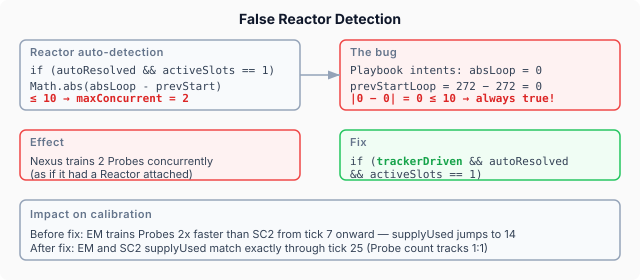
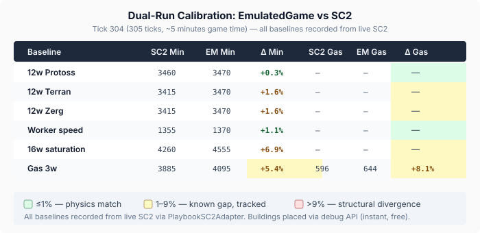

# What the Real Game Taught Back

The [previous entry](2026-11-09-mdp02-driving-the-real-game.md) built the calibration infrastructure — YAML playbooks that drive real SC2 and the emulator side by side, comparing every tick. It confirmed the per-worker mineral rate at under 1% error. But it also surfaced three open problems: the saturation model was too generous, the emulator disagreed with its own formula by 15%, and the gas adapter produced zero vespene.

This session I went after all three. What came back was more interesting than parameter tweaks. The calibration baselines found two production bugs in EmulatedGame that had been invisible for months — and the process of fixing them reframed how I think about what "accurate enough for training" actually means.

## The bugs the baselines found

The dual-run comparison works by running the same playbook through SC2 and the emulator, tick by tick, and flagging the first structural divergence — a unit count that differs, a building that appears at the wrong time. The mineral and vespene deltas are logged but don't stop the comparison. This means the first thing you see is a unit-count error, and you have to trace backward to find why.

### Snapshot timing

The 16-worker saturation baseline diverged at tick 12. SC2 had 12 Probes, the emulator had 13 — a Probe appeared one tick early. The Probe train time (272 game loops) was correct. The issue was when the snapshot was taken relative to the game tick.

SC2's API works on an observe-then-step cycle. You receive an observation, send actions, then the game advances one step. The observation reflects the state *before* the step runs. The emulator's calibrate loop was taking the snapshot *after* `game.tick()` — so a completion that fired during that tick was already visible in the snapshot, one observation ahead of where SC2 would report it.

The fix was one line moved: take the comparison snapshot before `game.tick()`, not after. The playbook commands still fire after the tick (using post-tick state for mineral and supply checks), but the structural comparison now aligns with SC2's observation timing.

### False Reactor detection

After fixing the snapshot timing, the 16-worker comparison diverged again at tick 20. The emulator had 14 Probes where SC2 had 13. Tracing the state tick by tick showed the emulator's `supplyUsed` jumping to 14 at tick 8 — two ticks after the playbook queued a second Probe for training. SC2's `supplyUsed` stayed at 13 until tick 13.

The emulator was training two Probes concurrently on a single Nexus. A Nexus has one production slot — concurrent training requires a Reactor addon, which only Terran buildings get. Something was giving the Nexus a Reactor.

The auto-detection logic existed for replay-driven simulation, where two units starting production on the same building within 10 game loops is a reliable Reactor signal. But playbook-driven intents always pass `absLoop=0` — and `|0 - 0| = 0 ≤ 10` is always true. Every building looked Reactored.

The fix was a single condition: restrict the auto-detection to tracker-driven intents. Playbook intents can't carry the loop-timing signal that the heuristic depends on.

After both fixes, Probe counts matched SC2 exactly through tick 25. The remaining divergence at tick 37 is from a different source — integer division of the 272-loop train time by 22 loops per tick distributes the fractional remainder on different Probes than SC2 does. Same total over every three Probes. Different phase.

## Gas: from zero to 8%

The gas adapter had two problems. The Assimilator build command was dispatched correctly to SC2's API, but SC2 silently dropped it — the worker command vanished without error or feedback. Switching to the debug API for Assimilator placement (consistent with how Pylons and Supply Depots were already handled) made it work. The second problem was worker assignment: SC2 doesn't auto-assign workers to completed gas buildings. I added an `assignWorkersToGas` method that detects newly completed gas buildings each tick and sends workers to them via the `HARVEST_GATHER` ability.

With both fixes, the gas baselines finally produced vespene:

- **3 workers on 1 geyser:** 44.3 vespene/min/worker in SC2
- **6 workers on 2 geysers:** 33.3 vespene/min/worker (25% contention penalty)

The emulator's gas harvest duration of 22 loops gives 45.9 vespene/min/worker in isolation — 3.7% above SC2. The full-playbook comparison is wider at 8%, mostly from geyser distance. The emulator seeds geysers at a fixed position; the real map's geyser-to-Nexus distance varies by spawn location. Recording the actual geyser coordinates from the SC2 observation and feeding them into the emulator's worker simulation would close most of that gap.

## The accuracy picture

The 12-worker Protoss baseline is the cleanest comparison — no training, no building, pure mining for 305 ticks. SC2 produces 3460 minerals, the emulator produces 3470. That's a 10-mineral delta over 3400 total income — **0.3%**. At tick 301 SC2 is ahead by 5 minerals. At tick 304 the emulator overtakes by 10. They oscillate around each other. The remaining noise is integer rounding: each mineral delivery is 5 minerals, and which sub-tick a worker completes a round trip varies by ±1 tick between the two engines.

Terran and Zerg are 1.6% above SC2 at the same 12-worker configuration. SC2 produces 3415 minerals for both races versus 3460 for Protoss — a per-race difference that the emulator doesn't yet model. The fix is a per-race mining efficiency factor, currently calibrated only for Protoss.

The 16-worker gap at 6.9% is almost entirely from training timing. Every Probe that arrives one tick early or late shifts its entire mining contribution. Over 11 trained Probes, those 1-tick phase shifts compound into a cumulative mineral delta. The per-worker rate is the same; the accumulated income differs because workers join the economy at slightly different ticks.

## What this means for training

The question I keep coming back to is whether the emulator is accurate enough to train a competitive SC2 agent. The answer depends on what "competitive" means, and the answer is different at different worker counts.

At 12 workers — the early game — the emulator is indistinguishable from SC2. A 0.3% mineral delta over five minutes produces no meaningful strategic difference. An agent that learns "build a Gateway at 150 minerals" in the emulator will find it equally valid in the real game. The economy signals are identical.

At 23 workers — mid-game saturation — the emulator overestimates income by about 7%. Over a seven-minute game, that's roughly 400 extra minerals. An agent trained in the emulator thinks it can afford its third expansion 20 seconds earlier than it actually can in SC2. For ladder play below Grandmaster, that's noise — opponent variation swamps it. For build-order-optimised play at the top level, it matters.

The path to closing that 7% has a clear technical shape: sub-tick training resolution, where completions fire at loop precision instead of tick precision. That eliminates the phase-shift compounding. It's a targeted change to `startTraining()` and `fireCompletions()` — not a rearchitecture. Seven issues now track every gap from the per-race mining factors through the gas contention model.

The gas rate at 8% is the wider gap, but gas income is structurally less important than minerals for early- and mid-game economy decisions. An 8% gas overestimate means technology timings are slightly optimistic — the agent researches Blink 4 seconds early. That's well within the variance of opponent behaviour.

## The broader observation

What I didn't expect was how the bugs would surface. Neither the snapshot timing nor the Reactor detection would have been found by unit tests. The snapshot timing is correct in isolation — the emulator takes a snapshot, the snapshot reflects the current state, the state is correct. It's only wrong relative to SC2's observation cycle, which is an external contract that no unit test checks. The Reactor detection passes every test where `absLoop` carries a real value, which it does in every replay-driven scenario. It fails only when `absLoop=0`, which only happens in playbook-driven calibration — a path that didn't exist until this calibration infrastructure was built.

This is the argument for driving the real system with controlled inputs, not just testing the model against itself. Self-consistency tests can't find bugs that are consistent. A model that always takes snapshots after ticks is self-consistent. A model that always detects Reactors on every building is self-consistent. The bugs surface when the model's output is compared against reality, tick by tick, with no tolerance for hand-waving.

The calibration infrastructure cost a full session to build. The bugs it found would have been invisible until an agent trained on the emulator performed measurably worse in real SC2 games — and the cause would have been buried under layers of reinforcement learning noise. Finding them now, with a deterministic comparison that points to the exact tick and the exact unit count, is cheaper by orders of magnitude.
