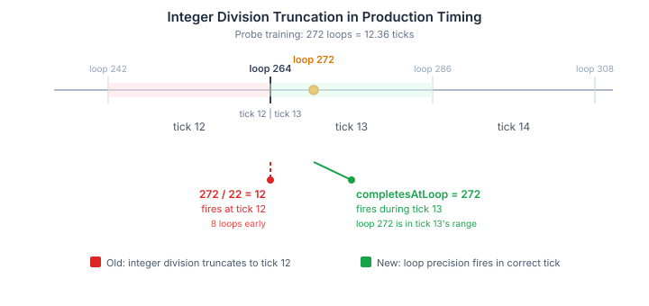
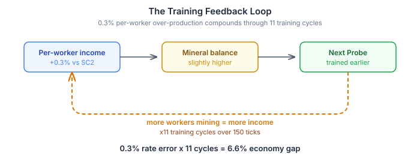

A Probe takes 272 game loops to train. Our simulation ticks every 22 loops. How many ticks does a Probe take?

The answer is not 12.

`272 / 22 = 12` by integer division. That is what we had. The `PendingCompletion` record stored a `completesAtTick`, computed by dividing the training loop count by the tick width and truncating. The unit appeared at tick 12.

The problem: tick 12 covers loops 242 through 263. Loop 272 is in tick 13. The Probe was appearing 8 loops before it should have existed.

This is the same class of error we fixed for worker mining and gas harvesting in earlier sessions. Sub-tick transitions at phase boundaries waste the fractional loops within a tick, creating a systematic directional bias: completions always fire early, never late. For a single Probe, 8 loops is trivial. For a continuous training ramp of 11 Probes across 150 ticks, it is not.

## The Fix Was Simple

We replaced `completesAtTick` with `completesAtLoop` in the `PendingCompletion` record. Instead of `gameFrame + (offset + trainLoops) / LOOPS_PER_TICK`, we store the raw loop: `absLoop + trainLoops`. The `fireCompletions` call passes `gameFrame * LOOPS_PER_TICK` and compares directly. No integer division, no truncation, no early-fire bias.

The Probe cadence shifted from `[12, 12, 13, 12, 12]` to `[13, 12, 13, 12, 12]`. Both produce the same 3-Probe period of 37 ticks. The first Probe now arrives one tick later. Every building and research completion gained the same correction — anything whose loop count does not divide evenly by 22 now fires in the correct tick instead of one tick early.

## The Surprise Was What It Did Not Fix

The motivation was a 6.9% mineral gap in the 16-worker dual-run calibration. The EM produced 4555 minerals at tick 304 while SC2 produced 4260. We attributed this to the integer-division phase shift in Probe training.

Fixing the cadence reduced the gap to 6.6%. Sixteen minerals out of 295.

The cadence was wrong, but it was not the cause.

## Finding the Actual Mechanism

We ran a controlled experiment: 16 workers from tick zero, no training, pure mining. The 16-worker income was exactly 1.333 times the 12-worker income. 16/12, to three decimal places. The per-worker rate was correct. The saturation contention model was correct. The physics were fine.

Then we checked the SC2 baseline data more carefully. The playbook does not stop training at 16 workers. It trains continuously to the supply cap. The SC2 game builds 23 Probes, not 16.

With 23 Probes trained over 150 ticks, each costing 50 minerals from the same income stream that determines when the next Probe can be afforded, any error in per-worker income feeds forward. The EM's per-worker income was 0.3% above SC2's — barely visible at 12 workers, invisible for any single training cycle. But through the training feedback loop, that 0.3% determines how quickly the next Probe can be afforded. A Probe that arrives one tick earlier mines for one more tick, adding to the income that funds the next Probe.

Eleven training cycles amplify a 0.3% rate error into a 6.6% economy gap. The mineral delta between EM and SC2 reached its full 285-mineral gap by tick 150 and stayed flat for the remaining 154 ticks. The steady-state income at 23 workers was identical between EM and SC2. The gap was established entirely during the ramp-up.

## The Last Place We Hadn't Looked

We already knew this. Sub-tick chaining for worker movement, mining, and gas harvesting established the principle months ago: never truncate to tick boundaries, keep everything at loop precision, let fractional remainders carry forward. Production completions were the last place where integer division was still silently rounding away information. Same error class, same fix pattern — but with a compounding mechanism that the worker phases never had, because trained units feed back into the income that funds the next one.

The cadence fix was a one-line semantic change. The economy fix is a 0.3% rate correction — from a mining efficiency factor of 1.0 to 0.997. We would not have isolated the factor without first eliminating the truncation that was hiding behind it.
