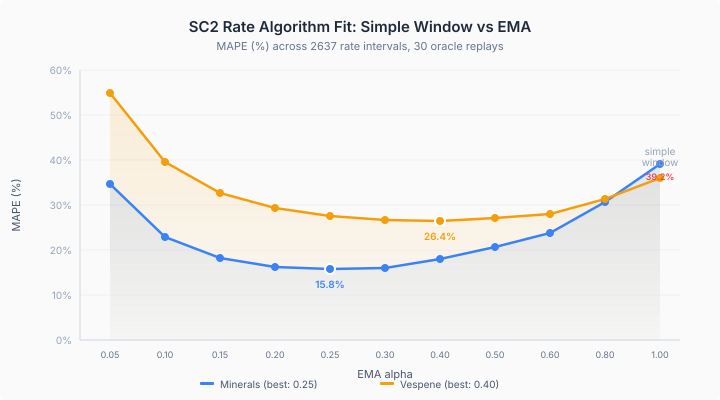

SC2 does not compute collection rates the way we thought.

We assumed a simple windowed average: accumulate income over 160 game loops, divide by elapsed time, report as minerals-per-minute. Our EconomyTracker did exactly this. The rate window aligned with SC2's PlayerStatsEvent cadence. The denominator used actual elapsed loops, not the configured threshold. By every reasonable standard, the implementation was correct.

It was wrong by 39%.

## Reverse-Engineering from Replay Data

The oracle replays contain both the raw resource quantities and SC2's reported collection rates at every PlayerStatsEvent. That gives us two things: the actual income between consecutive events (computed from the change in total resources mined), and the rate SC2 claims to have observed. If our algorithm matches SC2's, these should agree.

We computed `totalMined = mineralsCurrent + usedCurrentArmy + usedCurrentEconomy + usedCurrentTechnology + usedInProgressArmy + usedInProgressEcon + usedInProgressTech + lostArmy + lostEcon + lostTech` at each PlayerStatsEvent. The delta between consecutive events is the income. Divide by elapsed loops, scale to per-minute, and you have the instantaneous rate. Compare that with SC2's reported `mineralsCollectionRate`.

Simple windowed average: 39.2% MAPE across 2637 intervals and 30 replays.

Then we fitted exponential moving averages at eleven alpha values from 0.05 to 1.0 (where 1.0 is the simple window).



The minimum is at alpha 0.25 for minerals: 15.8% MAPE. For vespene, the minimum sits around 0.35 at 26.5%. The simple window is the worst fit in the entire sweep. SC2 smooths its rates. We were not smoothing ours.

## The Fix

EMA is straightforward. Each time the rate window fires:

```java
emaMineralRate = MINERAL_EMA_ALPHA * instantMinRate
              + (1 - MINERAL_EMA_ALPHA) * emaMineralRate;
```

The first window seeds the EMA with the instantaneous rate to avoid cold-start suppression. After that, each update blends 25% of the new observation with 75% of the accumulated history. The vespene channel uses a slightly higher alpha (0.35) because gas income is burstier — three workers per geyser create periodic harvest spikes that need faster tracking.

This also resolved two downstream issues without any code changes. The gas rate regression we had seen when switching from 154 to 176 loop windows disappeared entirely — the EMA absorbs the phase offset that was causing the simple window to sample different points in the gas harvest cycle. And the sub-tick rate tracking that was meant to align our window width exactly with SC2's became unnecessary — the proportional split proposed for that fix turned out to be mathematically identical to our existing denominator.

## The Part That Matters

We regenerated the standalone baseline. Rate MAPE: 32.4% for minerals, 28.2% for vespene. Unchanged.

The algorithm was wrong. We fixed it. The accuracy did not move.

This should not have been surprising. The aggregate MAPE measures total income error across all replays and all checkpoints. Whether we report that error as a jerky step function or a smooth EMA curve does not change how much mineral income the WorkerSimulation actually produces. The rate computation is the reporter. The mining physics is the source. We corrected the reporter while the source remained the same.

The EMA fix is still correct — we now match SC2's actual reporting algorithm, which matters for per-interval fidelity and for any downstream consumer that expects the rate to behave the way SC2's does. But it is not an accuracy improvement. The accuracy improvements are upstream, in the worker simulation physics: patch distances, harvest durations, gas contention, worker initialization delays. Those are the next eleven issues.

Matching the algorithm is necessary. Matching the physics is the work.
