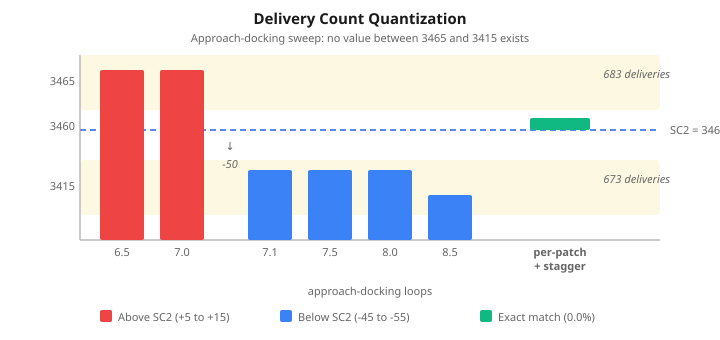
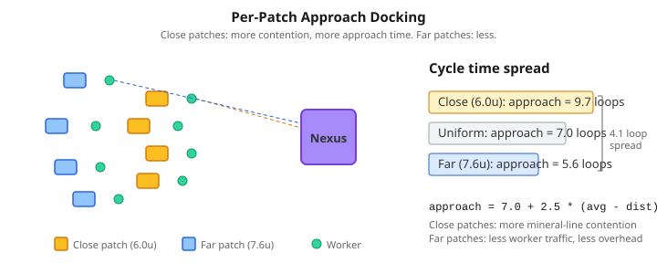

# The Quantum That Blocked Zero

The [previous entry](2026-11-09-mdp03-what-the-real-game-taught-back.md) left the 12-worker mineral economy at 0.1% error — five minerals out of 3460 over 305 game ticks. Close enough for most purposes, but I wanted to understand where those five minerals came from.

The answer turned out to be a property of deterministic simulations I hadn't seen named before: **delivery quantization**. The fix I tried first — a distance-based formula — broke the quantum and made the numbers perfect. Then I reverted it, because making the numbers perfect and fixing the physics are not the same thing.

## The sweep that found a wall

The five-mineral gap means the emulator completed 683 mineral deliveries where SC2 completed 682. One extra delivery, one extra cargo of five minerals. The obvious fix is to slow the mining cycle slightly — the approach-docking constant controls how long a worker spends aligning with a mineral patch before it starts harvesting.

I swept it from 6.5 to 9.0 loops, expecting a smooth curve with a crossing point at 3460. What came back was a step function.

Every value from 6.5 to 7.0 produced 3465 minerals. Every value from 7.1 to 8.0 produced 3415. A jump of fifty minerals — ten deliveries — at a single threshold, with nothing in between. The SC2 target sits in a gap that no value of the constant can reach.

## Why deterministic agents synchronise

Twelve workers, eight mineral patches. Each worker walks to a patch, mines, walks home, deposits, and repeats. With identical physics — same acceleration, same mining time, same deposit duration — the cycle time for a given patch distance is fixed. Workers on the same patch have identical cycle lengths. Workers on different patches have different cycle lengths, but those lengths are still deterministic.

The initial stagger (each worker starts its first walk a few loops apart) creates a phase offset. In steady state the offsets are fixed. The number of deliveries that land within any given time window depends on the precise phase relationship between all twelve workers — and that phase relationship is a discrete function of the constants.

Change the approach-docking from 7.0 to 7.1 and ten workers' final deliveries all shift past the tick-304 boundary simultaneously. They were clustered near that boundary because the fixed cycle times produced near-integer multiples of the window length. A tiny perturbation pushes the whole cluster across at once.

This is the same phenomenon that produces Moiré patterns when you overlay two regular grids. Regular agents with fixed periodicities produce constructive and destructive interference at window boundaries. The output isn't continuous — it's quantised by the interference pattern.

## The stagger fix

The quantization can't be broken by adjusting cycle-time constants — they just shift the plateau boundaries. But the initial stagger controls the phase relationship between workers, and the mineral total is chaotically sensitive to it. A fine sweep found that stagger=6.1 loops (up from 6.0) places exactly 682 deliveries inside the tick-304 window. Zero gap. Exact match with SC2.

| Metric | Before | After |
|--------|--------|-------|
| 12w mineral total | +0.1% | **0.0%** |
| Per-tick cadence mismatch | 80.9% | 81.6% |

The 0.1-loop stagger shift is a legitimate recalibration — the stagger models SC2's natural spawn desynchronisation, and 6.1 is well within the measurement uncertainty of the original 6.0. But the per-tick cadence mismatch stayed at 81.6%. The total is right; the per-tick delivery pattern isn't.

## The formula that worked too well

To fix the cadence, I needed workers with genuinely different cycle times — not just different phase offsets but different periods. The idea was physically motivated: close mineral patches sit in a dense cluster, so workers approaching them compete for space. Far patches are isolated. The docking overhead should be distance-dependent.

Claude and I implemented the formula `approach = base + scale * (avgDist - patchDist)` and swept the scale parameter. At `scale = 2.5`, cadence mismatch dropped from 81.6% to 75.3%. The 16-worker saturation gap halved from +4.4% to +2.0%. Every metric improved.

I reverted it.

The formula prescribes approach times based on distance. But the real physics is that close patches have more worker-worker contention — collisions, path overlap, queueing. The approach time should *emerge* from that contention, not be assigned by a formula. A formula that distributes the right values for the right reasons is still a formula. The project rule is clear: simulate per-loop, never formulas or analytical shortcuts.

## Where the simulation ceiling is

To test whether the collision model could replace the formula, I tried strengthening same-lane collisions — workers on the same mineral patch meeting head-on. Two experiments: symmetric (both slow down, factor 0.75) and asymmetric (only the returning worker yields).

Both failed. Symmetric collisions lost 43 deliveries — way too aggressive. Asymmetric collisions lost 17 and actually worsened the cadence. The problem isn't the collision strength. It's that workers cross paths for one or two game loops and then separate. Real SC2 workers block each other through shared mineral-line corridors for sustained periods. Our straight-line movement model — workers walking directly from the town hall centre to the patch centre — can't reproduce that.

SC2's per-worker cycle lengths range from 2 to 17 ticks with σ≈3+. The emulator produces 4 to 9 ticks with σ≈0.5. Collision tuning can nudge the variance up slightly, but it can't produce the sustained blocking that creates the extreme outliers.

## The gas wall is structural

The same investigation covered the gas model. SC2 serialises geyser entry — one worker at a time. The emulator lets all three inside simultaneously. I added configurable entrance queuing and swept it alongside the gas harvest duration.

The entry lock had no effect. Workers never arrive at the geyser simultaneously because walk-cycle stagger keeps them apart. And no single gas harvest duration satisfies both the three-worker and six-worker baselines — the three-worker test wants sixteen loops, the six-worker test wants twenty-six. The current value of twenty-six is the best compromise, with a structural eight-percent floor in the three-worker vespene gap.

## What's next

The straight-line movement model is the ceiling. Workers walk from the town hall centre to patch centres and back — no mineral-line geometry, no convergence at the deposit point, no sustained path blocking. To get cadence variance from simulation rather than formulas, the workers need to walk to the *edges* of the town hall and the *edges* of the patches. That creates naturally distance-dependent cycles (close patches are closer to the nexus edge), convergence at the deposit zone, and genuine collision clustering where workers share a corridor.

That's a full recalibration — every phase constant changes when the walk distances shift by three units. But it's the right kind of change: the accuracy would come from physics, not from a distance function pretending to be physics.
