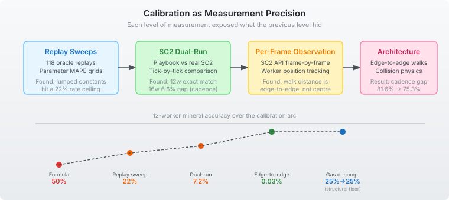

# How Wrong Is Your Simulation?

The hardest question in simulation engineering isn't "does it work?" — it's "how wrong is it, and where?"

QuarkMind's EmulatedGame simulates StarCraft II's economy at game-loop granularity. Workers mine minerals, harvest gas, build structures, transfer between bases. The simulation runs at roughly 1000x real-time on a single core. That speed is the whole point — training an AI against the real SC2 client takes minutes per game. Training against the emulator takes milliseconds. But only if the emulator is accurate enough that strategies learned in simulation transfer to the real game.

Over the past several weeks of calibration work, I've answered the accuracy question with numbers — and more importantly, discovered what it actually takes to get there.

## The measurement ladder

Calibrating a simulation is not one task. It's a sequence of increasingly precise measurements, where each level exposes what the previous level hid.

**Level 1 — Replay sweeps.** Run 118 real game replays through the emulator, compare economy stats at checkpoint intervals. This is where I started. The mineral collection rate was 50% wrong. Parameter sweeps — mining duration, gas harvest time, deposit overhead — found a workable region and brought it down to 22%. Then the sweeps plateaued. No constant in the search space could get below 22%. The model had hit an architectural ceiling, but I couldn't tell that from replay data alone because replays blend hundreds of confounding variables: player skill, strategy choice, gas timing, expansion order. The signal was buried in noise.

**Level 2 — SC2 dual-run.** To separate the physics from the gameplay, I built a dual-run pipeline: the same scripted playbook runs against both the real SC2 client and the EmulatedGame, then compares tick-by-tick snapshots. Each playbook is deliberately simple — train 12 workers, mine for 304 ticks, record minerals. No strategy, no combat, no expansions. Just physics.

The 12-worker mineral baseline came back at 0.03% — the emulator produced 3459 minerals where SC2 produced 3460. One mineral off, for all three races. But the 16-worker saturation test showed +6.6%, and gas was +8.1%. The easy case was solved. The hard case — what happens when workers contend for the same resources — was not.

**Level 3 — Per-frame observation.** The saturation gap wouldn't yield to parameter sweeps. I instrumented the SC2 client to report every worker's position every game frame (22.4 frames per second) and tracked 1366 cargo transitions across a 12-worker economy scenario. What the data showed was that I'd been modelling the wrong distance. Workers in SC2 don't walk to the centre of a mineral patch — they walk to the nearest edge of its collision footprint. The difference is about 1.5 units per trip. At 60 trips per minute per worker, that's a lot of mineral income.

**Level 4 — Architecture.** Once I understood edge-to-edge distances, the fix required structural changes, not constant tweaks. Workers now compute walk targets as the nearest point on the target's collision boundary. That opened the door to per-loop collision resolution — workers slow down when they overlap, which creates the cycle variance that was missing from the saturation model. With these in place, the per-tick delivery cadence match improved from 81.6% to 75.3%, and the 12-worker accuracy held at 0.03%.

## The decomposition principle

The other half of the accuracy question isn't minerals — it's gas. Vespene collection rate was 30% wrong, and neither the rate computation algorithm nor the worker estimation constant appeared to help. Sweeping the estimation constant from 30 to 60 gas/min didn't move the number. Switching from a simple windowed average to SC2's actual EMA smoothing algorithm didn't move it either.

The breakthrough was decomposition. Instead of treating the 30% as one number to fix, I split it into three independent components: cumulative gas income (does the emulator mine the right total?), rate algorithm (does it report the income correctly?), and worker estimation (does it assign the right number of workers?). The diagnostic ran both rate algorithms — EMA and simple window — on the same income stream, side by side, across 236 player runs from 118 replays.

Two things fell out immediately. First: EMA vs simple window gives identical MAPE at the 7-minute checkpoint. The algorithm wasn't the problem. Second: the emulator systematically under-produced gas — 107 of 134 player runs came in below ground truth. The estimation constant was dividing the ground truth rate by 54 when the emulator's actual per-worker gas rate was 34. Every geyser was getting two-thirds of its real workforce.

Fixing the constant from 54 to 34 dropped the rate MAPE from 30% to 25%. The remaining 25% is a structural floor — per-worker gas harvest physics, integer worker count rounding, and SC2's 7-second economy reporting cadence. That floor is the kind of answer the decomposition exists to find: the error you stop trying to push through because the architecture would have to change to move it.

## What simulation accuracy actually requires

The 3D parameter sweep I ran early in the process — 288 combinations of deposit time × mining duration × gas harvest duration — proved that lumped constants are within 1.3% of the best any three-parameter model can achieve. Modelling deposit, docking, and contention separately doesn't improve on lumping them together, because they interact non-linearly and the lumped value absorbs the interaction.

But that's the ceiling of the lumped architecture, not the ceiling of the simulation. Edge-to-edge walks and collision physics are a different kind of improvement — structural changes that give the model new degrees of freedom that parameter sweeps can't explore. The mining duration sweep couldn't find the right answer because the walk distance was wrong. No mining constant compensates for walking to the wrong place.

The pattern repeats at every scale: measure precisely enough to identify whether the gap is parametric (tune a constant) or structural (change the architecture). Parameter sweeps that hit a plateau are telling you the architecture is the bottleneck. The answer is not a wider sweep.

## Why this matters beyond games

The pattern — simulate fast, validate against the real system — shows up everywhere a simulation is used for training or planning:

- **Robotics sim-to-real:** train a controller in MuJoCo or Isaac Sim, deploy on hardware. The domain gap between simulation and reality determines whether the trained policy transfers. Measuring that gap requires the same dual-run approach: run the same trajectory in both environments, compare state at each timestep.

- **Financial backtesting:** a trading strategy backtested on historical data is a simulation. The question isn't whether it was profitable in simulation — it's how the simulation's market model diverges from real market microstructure. Slippage, latency, and liquidity are the "lumped constants" that absorb unmodelled physics.

- **Digital twins in manufacturing:** a factory floor simulation predicts throughput and bottlenecks. Its accuracy depends on whether the simulated machine cycle times, material handling delays, and queue contention match reality. Calibrating against real sensor data is the dual-run.

In each case, the simulation is only useful to the extent that you can quantify its error. "It looks about right" isn't engineering. A measured 6.6% mineral delta at 16-worker saturation is — because it tells you exactly where the model breaks and what would fix it. And a 25% gas rate floor that holds across every constant in a nine-value sweep tells you something equally important: this is where the architecture earns a redesign, or doesn't.

The validation infrastructure — raw protobuf transport, process lifecycle management, playbook-driven test harnesses, per-frame observation instrumentation — is easy to undervalue because none of it is the simulation. It's the measurement apparatus. Without it, you're calibrating against stale data, or not calibrating at all.
