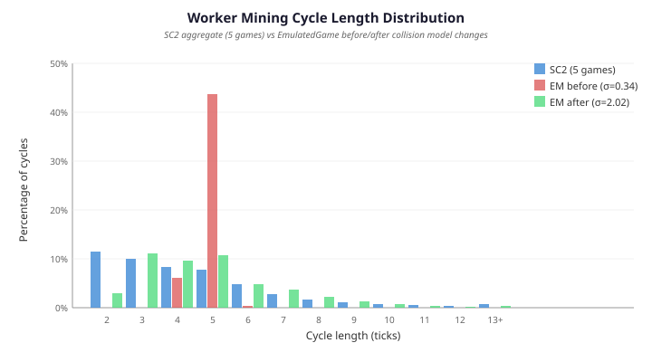
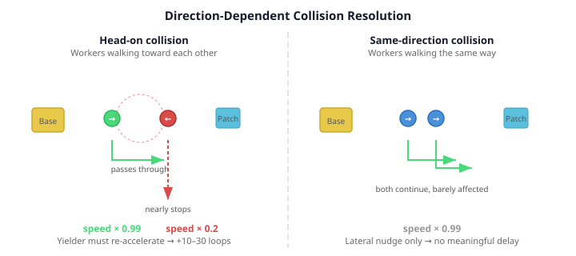

# The Variance Your Simulation Forgot

Your simulation gets the average right. The total mineral income at 5 minutes is within 0.1% of the real game. Every parameter has been swept, every constant calibrated. The aggregate numbers match.

Then you look at individual worker trips.

In StarCraft II, a Probe mining cycle — walk to patch, harvest, walk back, deposit — takes anywhere from 2 to 23 ticks. The distribution is right-skewed: about 43% of cycles complete in just 2–3 ticks, another 30% take 4–5, and a long tail stretches past 15. The standard deviation is 2.54 ticks. Every game produces a different sequence, but the statistical shape holds across runs.

In the EmulatedGame, the same 12 workers on the same mineral line produce cycles that are almost perfectly uniform: 87% land on exactly 5 ticks. The standard deviation is 0.34. The simulation is deterministic — same input, same output, every time.

The averages match. The distributions don't.

## SC2 isn't deterministic

I recorded five sequential games on the same map with the same setup — 12 Protoss Probes, no buildings, no training, just pure mining for 304 ticks. Same initial conditions, but SC2's internal pathfinding and collision resolution introduce enough non-determinism that the per-worker timing varies every game.

The aggregate distribution, though, is remarkably stable: mean 4.46, σ 2.53 across all five runs. The shape doesn't change. SC2's physics produces the same statistical fingerprint every game, even though no two games are identical at the individual-worker level.

This is the kind of detail that aggregate metrics hide. Total minerals match because the average trip length is right. But the variance — the thing that makes one worker finish in 2 ticks while another takes 17 — is a property of the collision physics, and our collision model wasn't producing it.

## What the collision model was doing wrong

The original model applied a uniform 4.8% speed reduction per collision. Two workers overlap, both get nudged sideways, both slow by the same factor. Direction doesn't matter — head-on is the same as side-by-side.

This produces narrow variance because every collision has the same cost. A worker that hits three collisions per trip slows by roughly 14%. A worker that hits zero doesn't. The difference is maybe one tick, not fifteen.

In SC2, workers physically block each other. A Probe walking toward a mineral patch encounters another Probe returning with cargo, and one of them has to yield — stop, wait, repath. The delay isn't a percentage; it's a dead stop followed by re-acceleration. A single bad encounter can add 10–30 game loops to a trip. Multiple encounters compound.

## Direction-dependent severity

The fix isn't a formula bolted onto the collision model. It's making the physics directional.

For each pair of colliding workers, compute the dot product of their travel directions. If they're heading toward each other (dot product below −0.3), one worker — the yielder, chosen deterministically by tag — gets its speed cut to 20% of current. The other passes through with the base factor (0.99 — essentially transparent). If they're heading the same way, both get the base factor. The displacement is unchanged — lateral push proportional to overlap — but the speed penalty now depends on whether the collision is a head-on block or a side-by-side brush.

Walking-into-stationary collisions — a worker hitting someone mining at a patch — always apply the harsh factor. In SC2, a stationary worker at a patch is a physical obstacle.

The asymmetry matters. Penalising both workers in a head-on collision doubles the mean impact without doubling the variance. Penalising only the yielder halves the mean shift while keeping the same maximum delay for the unlucky worker. The variance comes from some workers getting stuck while others sail through — not from everyone being equally slowed.

## Processing order — the missing randomness

Direction-dependent collisions got the variance halfway there. σ jumped from 0.34 to 2.02 — but SC2's 2.54 was still out of reach.

The remaining gap was in the processing order. SC2 randomises the order in which events are processed every game loop. Which worker reaches a patch first, which deposits first, which collision gets resolved first — all shuffled, every loop. The PySC2 docs call this "cosmetic," intended to make groups of units look less robotic. But for mining, it's structural.

With deterministic iteration (Java's `LinkedHashMap`), the same workers always win the same races. Worker 0 always reaches its patch before Worker 5. The collision penalty always falls on the same yielder. The result is a narrow distribution because the same workers are consistently lucky and the same are consistently unlucky.

Shuffling the processing order per loop — mineral worker steps, patch acquisition priority, and collision resolution order — breaks this. Now Worker 0 sometimes yields instead of Worker 5. The head-on collision penalty falls on different workers in different loops. The variance emerges naturally.

With the shuffle in place, the overhead phases that were removed to make room for collision-driven variance could be restored to their SC2-observed values (mining 22 loops, deposit 7 loops, approach/docking 11 loops). The variance now comes from the shuffle + collision physics, not from zeroing physical overheads.

## What matched, what didn't

| Metric | Original | Collision only | + Shuffle | SC2 |
|---|---|---|---|---|
| σ | 0.34 | 2.02 | 2.25 | 2.54 |
| Mean | 4.89 | 4.69 | 6.24 | 4.47 |
| Range | 4–6 | 2–19 | 3–20 | 2–23 |

The distribution is right-skewed with a long congestion tail. The tail extends past 15 ticks where it was previously capped at 6.

The remaining σ gap (2.25 vs 2.54) is from uniform mineral patch distances. The diagnostic uses 6–8 unit patches; real SC2 has patches from 3 to 6 units centre-to-centre. Close patches enable 2-tick cycles (21.4% of SC2 cycles) that uniform distances cannot reproduce. This is a patch geometry issue, not a collision or shuffle issue.

## Why this matters

A simulation that gets the average right but the variance wrong will train strategies that are too confident about timing. An AI that learns to expect mineral deliveries at exactly tick 5 every cycle will be surprised when the real game delivers them at tick 2, then tick 9, then tick 4. The average income is correct, but the cadence is wrong, and cadence drives build-order timing.

This applies beyond game AI. Any simulation used for training — robotics, financial backtesting, factory planning — has the same failure mode. The aggregate accuracy number looks good, but the distribution shape determines whether the trained behaviour transfers. A financial model with correct average returns but wrong volatility will underestimate risk. A robotics controller with correct average latency but wrong jitter will overcorrect on fast cycles and undercorrect on slow ones.

If your simulation is deterministic and the real system isn't, the variance gap is the thing your training will silently learn around — until it encounters reality.
