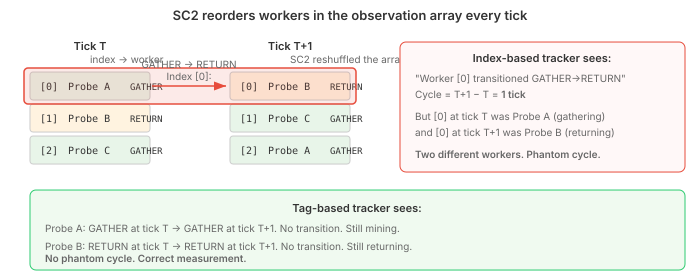
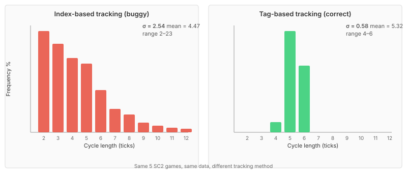

# The Variance Your Measurement Invented

The EmulatedGame gets the average right. Total mineral income at 5 minutes is within 0.1% of real StarCraft II. Every constant has been swept, every phase calibrated against controlled dual-run baselines. The aggregate numbers match.

Then you look at individual worker trips.

A Probe mining cycle — walk to patch, harvest, walk back, deposit — appears to take anywhere from 2 to 23 ticks. The distribution looks right-skewed: about 43% of cycles complete in 2–3 ticks, another 30% take 4–5, and a long tail stretches past 15. Standard deviation 2.54 ticks.

The EmulatedGame's 12 workers produce near-uniform cycles: 87% land on exactly 5 ticks. Standard deviation 0.34.

The gap is 7× on variance and the shape is entirely different. Clearly the simulation is too narrow, and the fix is more physics. A direction-dependent collision model, asymmetric yielding penalties, per-loop processing order shuffling — a week of work gets σ from 0.34 to 2.25. Close to the target.

Then you find the bug.

## The array reorder trap

SC2 reorders workers in the observation array every tick. The worker at index 0 in tick T is a different Probe than index 0 in tick T+1. The cycle length tracker was using array indices.

The tracker sees a GATHERING→RETURNING transition at index 0 — and records a 1-tick cycle. But index 0 was Probe A (gathering) last tick, and now it's Probe B (returning). Two different workers. The transition is phantom.

With 12 workers reshuffled into 12 slots every tick, phantom transitions outnumber real ones. Short phantoms dominate because each reshuffle has a high probability of placing a RETURNING worker where a GATHERING worker used to be.

Corrected — tracking by worker tag instead of array position — the SC2 distribution collapses:

| Metric | Index-based (buggy) | Tag-based (correct) |
|---|---|---|
| σ | 2.54 | **0.58** |
| Mean | 4.47 | **5.32** |
| Range | 2–23 | **4–6** |

SC2 mining cycles are almost perfectly uniform. 57% complete in exactly 5 ticks. 38% in 6 ticks. 6% in 4 ticks. Nothing outside that range, consistent across five sequential games.

The simulation at σ=0.34 was closer to reality than the "improved" version at σ=2.25.

## What the measurement drove

A week of physics changes, all chasing the wrong target:

**Direction-dependent collision model.** Head-on workers get their speed cut to 20%. Same-direction workers pass transparently at 99%. The asymmetry was elegant — it explained why some cycles take 15 ticks while others take 3. It also produced a congestion tail that real SC2 doesn't have.

**Acceleration from 3.5 to 10.0.** The original SC2Mapster value (2.5 normal × 1.4 faster) was too slow for the direction-dependent model — workers couldn't recover from head-on penalties fast enough. So the acceleration was tripled to compensate for a collision model that was compensating for a measurement bug.

**Phase overhead elimination.** Mining animation (22 loops), deposit (7 loops), and approach/docking (11 loops) — all measured from SC2 per-worker observation data — were zeroed out. The fixed overheads were "absorbing variance" that the simulation needed to produce. Removing them made room for collision-driven variance. But the variance was never there to produce.

Each change made the histogram match the buggy target more closely. Each was internally justified. None of them was correct.

## The tell that should have been obvious

Every SC2 worker achieved 2-tick cycles regardless of patch distance. Workers 6–8 units from the town hall cannot physically complete a round trip in 44 game loops. The walk alone takes 26 loops per leg at 3.5 u/s² acceleration. Add mining, deposit, and approach overhead — that's 106 loops minimum, nearly 5 ticks.

Two-tick cycles from 6-unit patches require either teleportation or a measurement error. The histogram had the right number of data points, plausible statistical properties, and a distribution shape consistent with a physical model. Nothing about it said "bug" unless you checked whether the physics could actually produce the numbers.

## What the fix looks like

Revert the direction-dependent collision model. Restore acceleration to 3.5. Restore the SC2-observed phase overheads. Keep the per-loop processing order shuffle — SC2 does randomise event order every game loop, and the shuffle is correct physics, even though its contribution to variance is small.

| Metric | Pre-#634 | After fix | SC2 |
|---|---|---|---|
| σ | 0.34 | 0.90 | 0.58 |
| Mean | 4.89 | 5.32 | 5.32 |
| 4-tick | — | 6.7% | 5.7% |
| 5-tick | 87% | 65.6% | 56.8% |
| 6-tick | — | 21.4% | 37.5% |

Mean matches exactly. The 4-tick bucket matches within a percentage point. The 5/6 split is still off — the EM peaks at 5 where SC2 spreads more evenly between 5 and 6 — but the shape is the same distribution, not a different one.

## Why this matters beyond game AI

The pattern — measurement error driving a cascade of compensating physics changes — is not specific to StarCraft emulation. It appears wherever simulation accuracy is measured against observations from a system you don't fully control.

**Robotics.** You measure end-effector position at 100 Hz. The sensor reports positions that bounce between consecutive readings. You add a damping model. The damping model needs a spring constant, which you calibrate against the bouncy readings. Later you discover the sensor has a bus contention issue — readings from different joints occasionally appear in the wrong channel. The "bounce" was crosstalk, not physics. Your damping model is now compensating for a data bus artefact.

**Financial backtesting.** You compute per-trade latency from order timestamps. The distribution has a fat tail — some trades appear to take 500ms. You model queue contention and add a stochastic delay. Later you discover the timestamp source switches between two clocks with a 200ms offset. The "slow trades" were clock skew, not execution delay. Your contention model is fighting a clock.

**Factory simulation.** You measure part arrival times at a station. The variance is high. You model conveyor belt vibration. The vibration model needs a friction coefficient. Later you discover the sensor occasionally double-counts — a part that bounces through the beam registers twice, and the second "arrival" looks like a fast cycle. The high variance was double-counting, not vibration.

The failure mode is the same in every case. You have a system (the simulation) and a reference (the measurement). When they disagree, you fix the system. You add complexity — models, parameters, tuning. Each addition is internally coherent. The simulation converges toward the measurement. And the measurement is wrong.

The corrective isn't "don't trust measurements." It's simpler: when a measurement implies physics that can't happen, check the measurement before adding the physics. A 2-tick cycle from a 6-unit patch is physically impossible. That observation should have triggered a measurement audit, not a collision model redesign.

Measure twice. Simulate once.
