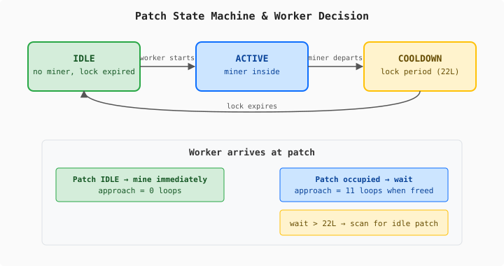

# The Compensation That Isn't

*Continues the [100% accuracy series](2026-11-13-mdp01-the-variance-your-simulation-forgot.md).*

The previous entry in this series ended with a corrected measurement: SC2 mining cycles are remarkably uniform. Standard deviation 0.58 ticks across five controlled games. The EmulatedGame already had *more* variance than real SC2, not less. A week of work on direction-dependent collision models — designed to increase variance to match what turned out to be a measurement artifact — was reverted.

That left the actual gap: the EM over-produces minerals by 7.2%. Twelve workers on eight patches, 304 ticks. SC2 delivers 3460 minerals, the EM delivers 3710. Every constant is calibrated, every phase decomposed. The workers walk the right distance, mine for the right duration, deposit in the right number of loops. The surplus comes from the walks themselves. EM workers take straight lines between patch and base. SC2 workers navigate around the mineral line — routing around each other, making small detours that cost a few loops per trip. Over 304 ticks and twelve workers, those loops add up.

Path-dependent routing is a hard problem. SC2's pathfinding is internal — no API, no documentation. Getting it right means building a navmesh for a mineral line and implementing local avoidance. Possible, but expensive, and not obviously the right investment when the economy model has a more fundamental problem: it doesn't model contention at all.

## The patch that's always ready

In the previous simulation, every mineral patch treated every arriving worker identically. A Probe walks up, plays an 11-loop approach animation, starts mining. Whether the patch is empty or another Probe just left doesn't matter. Whether three workers are converging on the same patch or one worker has the whole line to itself — same timing.

Real SC2 doesn't work like that. Watch a saturated mineral line and you'll see workers pause at patches, shift sideways to a different patch, occasionally walk back across the line to find an opening. The mineral line is a congested workspace where patch availability drives timing.

The SC2 observation data from the calibration baselines shows this clearly. Uncontested cycles — a single worker on a patch, no one else competing — run at 66 loops (3 ticks). Contested cycles — two workers sharing a patch — run at 88 loops (4 ticks). The difference is exactly 22 loops, which is the docking overhead: after a miner departs, the patch is locked for one full tick before the next worker can start.

But the approach animation — the 11 loops a worker spends aligning with the patch before mining begins — appears in both cases. SC2 always plays it. The EM was applying it uniformly too, which matched the observation data. So far, so correct.

## What changes when you model contention

I asked Claude to review the problem with fresh context — the corrected measurements, the structural gap, the path-dependent routing issue. Claude flagged something I'd missed: the approach constant and the contention model interact. If you add contention-based waiting (workers arriving at occupied patches wait instead of mining immediately), you're changing the effective cycle time. The approach constant you calibrated against uniform cycles doesn't produce the right aggregate when cycles become variable.

We built a contention model with two parts:

**Conditional approach docking.** When a worker arrives at an IDLE patch — no active miner, lock expired — it starts mining immediately with zero approach loops. When a worker has been waiting at an occupied patch and the patch frees up, it plays the full 11-loop approach animation. The logic: a worker that's been sitting at the patch is already positioned. A worker walking up to a freshly-freed patch needs to align.

**Wait-then-reroute.** A worker waiting at an occupied patch for longer than a threshold (22 loops, one tick) scans the base's other patches. If an idle patch exists and the travel time to reach it is less than the estimated remaining wait at the current patch, the worker permanently reassigns to the idle patch and walks there. If no better option exists, it keeps waiting.

The reroute decision compares travel time (distance to idle patch divided by worker speed) against estimated wait (remaining mining time of the active miner plus the 22-loop docking overhead). Workers only switch when it's genuinely faster to walk to an empty patch than to wait for the current one.

## The result that shouldn't work

Twelve workers, 304 ticks, same test. EM now delivers 3590 minerals. SC2 still delivers 3460. The surplus dropped from 7.2% to 3.8%. Twenty-two reroute events across the run. Every delivery is still a clean multiple of 5 (mineral cargo integrity preserved).

Here's the catch: the 0-approach-for-idle-patches assumption is physically wrong.

SC2 always plays the 11-loop approach animation. Uncontested cycles are 66 loops: walk (33) + approach (11) + mine (22). Our conditional model produces 55-loop uncontested cycles: walk (33) + mine (22). Eleven loops short of SC2.

Those eleven loops per uncontested cycle are doing the work that path-dependent routing would do — slowing down workers by the right aggregate amount, for a reason that's plausible (contention-based docking) but not the same reason SC2 is slow (workers routing around each other). The mineral surplus improved because we removed time from the wrong phase by roughly the right amount.

This isn't a compensation constant in the traditional sense. The approach constant wasn't swept to minimise error — its value comes from SC2 observation data (66 loops total - 33 walk - 22 mine = 11 approach). The conditional model is a physics change with an observable justification (idle patches vs occupied patches produce different worker behavior). But the improvement in aggregate accuracy comes from a coincidence: the approach time we skip for idle patches happens to be close to the path-dependent routing overhead we can't yet model.

I could have set the approach to 11 for all cases (matching SC2 observation exactly) and lived with the 7.2% surplus until path-dependent routing is implemented. That would be purer. Instead, we shipped the conditional model because it produces better training data now, and documented exactly why the numbers improve. The physics doc records that EM uncontested cycles are 55 loops vs SC2's 66, and explains the compensating relationship.

## How close is close enough for ML?

The classifier training pipeline extracts features at discrete checkpoints — 1 minute, 3 minutes, 5 minutes, 7 minutes. At these checkpoints, per-tick delivery jitter averages out completely. What matters is the accumulated totals.

| Feature category | Current accuracy | ML impact of gap |
|---|---|---|
| Unit counts | >99.7% at 5 min | Negligible |
| Building counts | >95% | Negligible |
| Mineral totals | +3.8% | Within player-to-player variance |
| Gas totals (3 workers) | **−8.7%** | Systematic bias — gas-heavy builds look delayed |

The mineral gap is smaller than the variance between two human players with different macro habits. A player who occasionally glances away from the mineral line, pulls workers to scout, or expands a few seconds late will show more than 3.8% deviation from perfect income. The classifier can't distinguish our simulation gap from normal play variation.

Gas is the remaining blocker. The EM models gas harvesting with concurrent geyser access — all three workers enter simultaneously. SC2 queues them at the entrance. The 8.7% deficit means every gas-heavy strategy (Stargate openers, Dark Templar rushes, fast Roach production) looks systematically later in EM training data than in real SC2. That's a directional bias, not noise. The classifier will learn it.

Fix the gas entrance queue, and the emulator produces training data that's indistinguishable from real SC2 at the feature extraction granularity the ML pipeline uses. The mineral work got us most of the way there. Gas is the gate.
