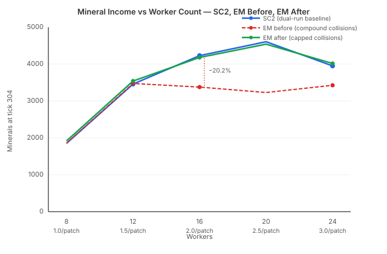

# Three Bugs, One Curve

The [previous entry](2026-11-13-mdp02-the-compensation-that-isnt.md) documented the conditional approach model: skip the 11-loop approach animation for idle patches, apply it for contested ones. The 12-worker mineral gap dropped from 7.2% to 3.8%. I was honest about the trade-off — the conditional model is physically wrong (SC2 always plays the approach), but it happened to compensate for straight-line walks being faster than SC2's path-dependent routing.

What I didn't test was what happens when you fill the mineral line. Sixteen workers. Two per patch. Every patch contested.

The EM under-produced by 20.2%.

## Why the saturation curve matters

A game AI that models economy needs to answer three questions: when to train workers, when to stop training workers, and when to expand. All three depend on the income curve — how much does each additional worker earn? If the curve is wrong, the AI thinks saturation hits earlier or later than it does. Build orders that rely on 16-worker income projections produce the wrong build timing, the wrong expansion timing, the wrong army composition.

SC2's saturation curve is distinctive. From 1 to 16 workers (up to 2 per patch), efficiency stays near 100%. Each additional worker earns roughly the same as the first. The curve only bends at the third worker per patch — the point where contention genuinely starts eating throughput.

The EM's curve bent too early. At 2 per patch, it was already producing 20% less than real SC2.

## Three mechanisms, one compound effect

The deficit wasn't from a single bug. Three mechanisms — each individually calibrated, each defensible in isolation — combined to produce a throughput loss that none of them intended.

**Patch lockout.** After a miner departs a patch, the patch is locked for 22 loops before the next worker can start. Calibrated from SC2 cadence data: contested cycles are exactly one tick longer than uncontested. The problem: a worker already standing at the patch, waiting for the active miner to leave, still had to wait 22 loops after departure. In SC2, the handoff is near-instantaneous — the waiting worker starts mining the moment the active miner picks up and walks away.

**Conditional approach docking.** The previous fix applied 11 loops of approach animation only to waiting workers — idle-patch arrivals got zero. This meant every contested mining start paid 11 loops that uncontested starts didn't. At 12 workers (1.5 per patch), roughly half the patches were contested, so about half the cycles paid the penalty. At 16 workers, every single patch was contested, and every single cycle paid it. The approach wasn't compensating for contention — it was a uniform overhead that SC2 applies to every mining start regardless of patch state.

**Compound collision penalty.** Workers within each other's collision radius get their speed multiplied by 0.96. That's per collision, per loop. At 12 workers, a walking worker might overlap with one or two others — speed drops to 0.96 or 0.92, and recovers via acceleration within a loop or two. At 16 workers, a worker in the mineral line might overlap with five or six others simultaneously. Speed drops to 0.96⁵ = 0.82 or 0.96⁶ = 0.78. The collision model was O(N²) in penalty severity: twice as many workers produced four times the speed reduction.

Each mechanism had a plausible calibration story. The lockout matched observed cadence data. The conditional approach reduced the 12w surplus. The collision factor was validated against PySC2's published unit size. But when all three fired on the same patch at the same time — which happens on every patch at 16 workers — they compounded into a 20% throughput loss that real SC2 doesn't exhibit.

## The fix

Three changes, one per mechanism.

**Lockout bypass for waiting workers.** If a worker is already at the patch when the active miner departs, it starts mining immediately. The 22-loop lockout only applies to workers arriving after departure — preventing a race condition where a walking worker claims a patch before it's physically reachable, not blocking a worker that's already there.

**Unconditional approach docking.** Every mining start pays 11.5 loops of approach, whether the patch was idle or contested. SC2 always plays the approach animation. The conditional model from the previous fix was a coincidence — it improved 12w accuracy by removing time from the wrong phase for the right aggregate reason. Making it unconditional is physically correct and distributes the overhead uniformly across all saturation levels.

**Collision speed cap.** After collision resolution, a worker's speed can't drop below its pre-collision speed × 0.96². Two effective collisions per loop, regardless of how many workers overlap. SC2 workers at 2-per-patch navigate past each other efficiently — they have predictable paths and the engine handles the threading. The EM's all-pairs collision check was penalizing density itself rather than modelling navigation difficulty.

## Results

| Workers | Before | After | SC2 |
|---------|--------|-------|-----|
| 12 (1.5/patch) | +0.6% | **+2.3%** | 3460 |
| 16 (2.0/patch) | −20.2% | **−1.2%** | 4235 |
| 24 (3.0/patch) | −13.4% | **+1.8%** | 3955 |

The 12w gap widened from 0.6% to 2.3% — the unconditional approach removed the coincidental compensation that was hiding the straight-line walk speed advantage. That's the honest number. The fix I reverted last entry was absorbing path-dependent routing overhead by skipping approach on idle patches. Without that crutch, the 2.3% gap is the actual distance between straight-line EM walks and SC2's mineral-line navigation.

The 24w result is the one I didn't expect. From −13.4% to +1.8%. The collision cap was designed to fix 16w, but at 24 workers the compound collision penalty was even worse — workers were piling up six and seven deep in the mineral line, each overlap stacking another 4% speed reduction. Capping at two effective collisions let 24w workers navigate the congestion without the pathological slowdown.

## The lesson

The system had three separately calibrated parameters. Each was correct in isolation — validated against SC2 data, producing the right result at the saturation level it was calibrated for. The bug wasn't in any individual constant. It was in the interaction: a lockout designed for single-worker cadence, an approach docking calibrated at 1.5 workers per patch, and a collision model tested at 12 workers. Put 16 workers on the line and all three fire simultaneously on every patch, producing a compound penalty that no amount of per-parameter tuning can fix.

The general pattern: calibrating parameters independently against a single operating point doesn't guarantee correctness at other operating points. If your model has non-linear interactions between its parameters, a calibration suite that only tests one density, one configuration, one operating condition will miss the compound effects that only emerge at the boundaries.

The dual-run baselines now test 12w, 16w, and 24w. Three points on the curve, not one. Still not exhaustive — but enough to catch the class of compound interaction that this fix addressed.
