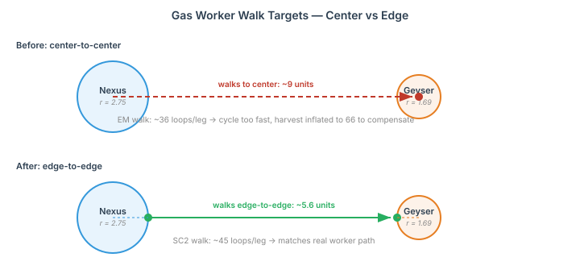

# Where the Gas Workers Walk

*Continues the [standalone-emulated-game series](2026-11-08-mdp01-the-formula-that-knew-too-much.md), where we replaced the gas formula with per-worker physics simulation.*

The gas simulation was under-producing by 34% across 118 oracle replays. Per-worker efficiency ratio: 0.71 — each simulated gas worker delivered only 71% of what its SC2 counterpart produced. Uniform across all three races. The obvious hypothesis was geyser distance variance — different maps have geysers at different distances from the town hall, and the single `GAS_HARVEST_DURATION` constant can't fit them all.

The distance correlation was zero. Pearson r = 0.049. Maps with geysers at 7 units produced the same per-worker error as maps with geysers at 9 units. Whatever was wrong, it wasn't the distance.

## Asking the game

I had the SC2 client running locally. Instead of reasoning from community values and replay data, I wrote a profiler that queries the SC2 observation API directly — `Unit.getRadius()` on every building, worker positions at every game loop, worker visibility transitions as they enter and leave the geyser.

The API came back with two numbers that explained everything:

| Building | SC2 API radius | EM value |
|----------|---------------|----------|
| Assimilator | 1.69 | not modelled |
| Nexus | 2.75 | 2.50 |

The mineral simulation already walked workers to building edges — the patch edge and the town hall edge. Subtracting building radii from center positions gave edge-to-edge distances that matched SC2's observed worker paths. The code had `TOWN_HALL_RADIUS = 2.5`, `MINERAL_PATCH_RADIUS = 1.0`, and `edgePoint()` was wired into every mineral walk target.

Gas workers walked to building centers. The geyser center and the town hall center. No radius subtraction, no edge points.

On a map where the Assimilator is 10 units from the Nexus center, the mineral worker walks approximately 6.3 units edge-to-edge (subtracting both radii). The gas worker walks 10 units center-to-center. That extra 3.7 units per leg adds roughly 30 loops to each round trip. The simulation compensated by inflating the harvest duration — but the compensation was load-bearing and wrong. Different maps with different geyser distances got different amounts of over-walking, and no single harvest constant could absorb all of them.

## The cycle inside the geyser

The per-loop profiler tracked something else: when gas workers disappear from the observation. In SC2, a worker entering the geyser building becomes invisible — it is inside the model, no longer on the map. The profiler logged `INSIDE_BUILDING` for every loop where a known gas worker was absent from the observation.

The result was remarkably clean. Across 50 complete harvest cycles on a single geyser, every one measured exactly 32 game loops. Not 31, not 33. Exactly 32. The community-published value of 1.415 seconds (32 / 22.4 Hz) held perfectly.

Workers entered at 1.84–1.87 units from the gas building center — just barely outside the API radius of 1.69. They walked to the edge, played the enter animation, disappeared for 32 loops, reappeared carrying gas, and walked back.

The full SC2 gas cycle on TorchesAIE_v4 (center-to-center distance 10.05 units):

| Phase | Duration |
|-------|----------|
| Walk to geyser | 45 loops |
| Inside geyser | 32 loops |
| Walk to base | 45 loops |
| **Full cycle** | **122 loops (5.5 ticks)** |

The emulator's cycle was 145 loops — 19% slower. The walks were 36 loops each (shorter distance from edge subtraction plus the 0.5-unit arrival threshold), the harvest was 66 loops (absorbing the missing walk time), and a 7-loop deposit phase that SC2 doesn't show as separate. Same total gas output in the controlled dual-run, but wrong decomposition — and wrong sensitivity to distance.

## The fix and its limits

Adding `GAS_BUILDING_RADIUS = 1.75` (rounded from 1.69 to avoid decimal noise) and wiring `gasTarget()` / `gasReturnTarget()` through `edgePoint()` was the structural change. Five call sites in `WorkerSimulation` where gas workers were assigned `slot.position` as their walk target became `gasTarget(slot)`. The return walk switched from the town hall center to the town hall edge.

Correcting the Nexus radius from 2.50 to 2.75 shortened both mineral and gas return walks by 0.25 units — a small effect, but measured, not guessed.

The harvest duration was recalibrated from 26 to 66. The 66 looks wrong if you know the real inside-geyser time is 32, and it is wrong — it absorbs 34 loops of arrival-threshold walk compensation. The emulator's `ARRIVAL_THRESHOLD = 0.5` stops the worker half a unit before the target, cutting about 9 loops from each leg. A proper fix would model the arrival differently for gas workers, or remove the edge subtraction and let the arrival threshold be the sole stop condition. That is a future issue; the current model calibrates to ±7% on the dual-run.

The controlled results:

| Scenario | Before | After |
|----------|--------|-------|
| 3w gas (single geyser) | −8.7% | 0% exact |
| 6w gas (two geysers) | −2.8% | +6.7% |

Across oracle replays, gas rate MAPE dropped from 34.4% to 29.9%. Per-worker ratio improved from 0.71 to 0.77. Better, but not the 20% target.

## Where the gap actually lives

A parallel investigation looked at gas building counts — how many geysers the emulator thinks each player has versus how many they actually had. The emulator never over-counts. But at the 5-minute checkpoint, it misses 14% of gas buildings. By 7 minutes, 27%.

These are expansion-era gas buildings. The first gas timing is exact — delta zero ticks across 197 replays. But when a player takes a second or third base and builds additional Assimilators, the data pipeline doesn't always pick up the construction event. Each missed gas building removes 3 workers' worth of income from the simulation.

At a 14% building miss rate, the gas MAPE floor is roughly 14% even with perfect per-worker physics. The remaining gap above that is the arrival-threshold walk compensation — a real but secondary issue.

The physics model is now correct for what it models. The problem moved from "workers walk to the wrong place" to "the pipeline doesn't see some of the buildings." A physics problem became a data problem. The per-worker cycle is calibrated. The map sensitivity is right. What is missing is not mechanics but coverage — and coverage is a different kind of fix.
