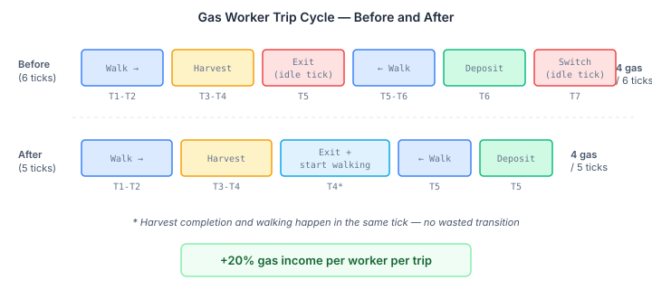

# Sixty-Six Was Doing Two Jobs

*Continues the [standalone-emulated-game series](2026-11-15-mdp01-where-the-gas-workers-walk.md), where edge-to-edge walk targets were added for gas workers.*

After fixing gas building counts in [#671](https://github.com/casehubio/quarkmind/issues/671) — tag-based dedup brought coverage from 86% to 100% — the gas rate MAPE at 5 minutes was still 29.9%. Protoss 27.2%, Terran 24.0%, Zerg 31.8%. The target is below 25% for all races.

The building count was right. The per-worker rate was not.

## What sixty-six meant

`GAS_HARVEST_DURATION_LOOPS = 66` was set after the edge-to-edge walk fix landed. The previous walk targets (building centers instead of edges) had over-walked by roughly 3–4 units per leg. Edge-to-edge targeting shortened the walks. The harvest constant was inflated to absorb the difference and keep the dual-run totals correct.

That worked on the controlled scenario — 3 workers on 1 geyser, 304 ticks, single map. But it embedded a hidden assumption: that the walk shortening is constant across all situations. It isn't. The EM's 0.5-unit arrival threshold shortens each walk leg by roughly 9 loops regardless of distance, but that 9-loop shortening interacts with geyser placement, worker assignment order, and expansion timing. The 66 that calibrated correctly against TorchesAIE_v4 at 3 workers produced consistent under-collection against 118 oracle replays at 5 minutes.

The cycle was wrong in a way that passed the aggregate test.

## The decomposition

The mineral model already has this right. Mining decomposes into three measured phases: `MINING_DURATION_LOOPS = 22` (time drilling the patch), `approachDockingLoops = 11.5` (per-patch calibrated entry overhead), and walk time computed from actual distances. No single constant absorbs two effects.

The SC2 profiler established the geyser harvest time at exactly 32 loops — 50 consecutive cycles, all 32, range zero. What remained was modelling the entry overhead: the worker arriving at the geyser edge, queuing behind other workers at the same building, beginning the harvest. That overhead isn't the same as the walk shortening from the arrival threshold, and conflating them is what made 66 brittle.

Decomposing: `GAS_HARVEST_DURATION_LOOPS = 32` (measured) plus `GAS_APPROACH_DOCKING_LOOPS = 11.5` (calibrated). The cycle:

| Phase | SC2 | EM pre-#675 | EM post-#675 |
|-------|-----|-------------|--------------|
| Walk to geyser | 45 loops | ~36 loops | ~36 loops |
| Approach / dock | — | — | 11.5 loops |
| Inside geyser | 32 loops | 66 loops | 32 loops |
| Walk to base | 45 loops | ~36 loops | ~36 loops |
| Deposit | — | 7 loops | 7 loops |
| **Total** | **122 loops** | **~145 loops** | **~122.5 loops** |

The cycle went from 19% too long to essentially correct. Per-worker income went from ~84% of SC2 to ~98%. Gas rate MAPE at 5 minutes: 29.9% → 15.3%. Protoss 27.2%→15.2%, Terran 24.0%→13.4%, Zerg 31.8%→25.4%.

## The rate algorithm

The 15% residual prompted a look at how SC2 computes `vespeneCollectionRate`. The emulator uses an exponential moving average over delta(grossVespene), alpha tuned to 0.35 — the best fit from sweeping 11 alpha values against 30 oracle replays. That sweep established the EMA approach and the floor: even with the best alpha, mineral rate MAPE was 15.8% and gas was around 26%.

The oracle trace revealed something else. Every `mineralsCollectionRate` value in the PlayerStatsEvents — after the ramp-up interval — satisfies `rate ≡ 27 (mod 28)`. Every one. Protoss, Terran, Zerg, across 118 replays.

That's a quantisation fingerprint. Five minerals per delivery, 1344 game loops per minute, 240-loop window: `5 × 1344 / 240 = 28`. SC2 counts discrete deliveries in a 240-loop sliding window and reports `deliveries × 28 - 1` (integer truncation). It's not an EMA. It's a window counter.

Implementing this in the emulator made things worse — 18.8% gas MAPE instead of 15.3%. The EMA was smoothing over delivery timing errors between the EM and SC2. The window approach is correct in principle but requires the EM's per-delivery timing to match SC2's first. That's the work for the next set of physics issues.

The finding is documented. The window is deferred.

## The expansion rebalance

One more change: `rebalanceGasWorkers()` was not being called after `syncMineralWorkersFromGt()`. When the harness moves mineral workers between bases — simulating a player transferring workers to a new expansion — undersaturated gas slots at the destination didn't pick up new workers until the next time a gas worker died. The rebalance call now runs after every mineral sync.

The MAPE impact was minimal — gas workers were already being assigned correctly when gas buildings completed via `onGasBuildingCompleted`. But the rebalance ensures that geysers built before enough workers arrived at the expansion base don't stay undersaturated indefinitely. The `MIN_MINERAL_WORKERS_BEFORE_GAS` threshold was lowered from 8 to 4 to match realistic expansion saturation curves — players put workers on gas once a base has 6–7 workers, not 11.
