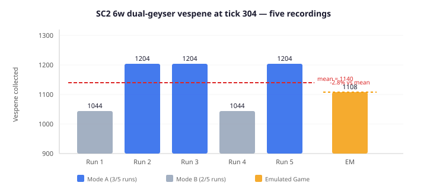

The gas physics work left one open question: a -8.0% vespene deficit in dual-geyser mode. The emulator produced 1108 gas where SC2 produced 1204. The obvious suspect was the deposit lock — an 8-loop serialisation at the town hall that prevents simultaneous gas deposits. With six workers sharing one TH, the lock should bottleneck throughput.

I swept the lock duration from 0 to 16. Zero throughput change at every value.

## The lock that never fires

The gas worker cycle in the emulator runs in a rotation-limited regime. Three workers share one geyser with `MAX_INSIDE=1` — only one harvests at a time. The harvest phase takes 31.7 loops, the approach adds 11.5, and the round-trip walk takes about 90 loops. By the time a worker returns to the town hall, the next geyser delivery is dozens of loops away. No two workers deposit close enough in time for the lock to trigger.

This is counterintuitive. Six workers on two geysers sounds like heavy traffic at the town hall. But the geysers pace the cycle, not the deposits. Workers leave each geyser in a staggered stream — roughly one delivery every 30 loops per geyser. At the town hall, the two streams naturally interleave. The phase-shift stabilisation we observed earlier means they stay interleaved: any coincidental collision creates a one-time offset that prevents future collisions.

The lock triggers 22 times in 6710 loops. All in transient clusters that immediately self-correct. Total blocked time: 71 loops across all workers. On a 300-tick test, that is measurement noise.

## Docking can't fix both numbers

The next thing I tried was the approach docking constant — the cycle overhead that accounts for entry animations and positioning delays. If the docking is too long, the cycle is too slow; if too short, too fast. Perhaps the dual-geyser deficit was simply a miscalibrated docking.

The sweep told a clear story. At docking=16 loops, the single-geyser result matches SC2 perfectly (552 vs 552). But the dual-geyser deficit worsens to -10.6%. At docking=8, dual-geyser improves to -4.7%, but single-geyser overproduces by +6.5%. The combined error stays between 10.6% and 11.4% at every value tested.

No docking value improves both configurations simultaneously. The deficit is not a parameter problem.

## SC2 rolls dice

The answer came from the data we already had. Five identical SC2 recordings of the same 6-worker dual-geyser scenario:

Three runs produce 1204 gas. Two runs produce 1044. Nothing in between. The emulator's 1204-gas target was one mode of a bimodal distribution, not the central tendency.

SC2 uses randomised event processing order per game loop — documented by DeepMind's PySC2 team. With six workers sharing approach paths and two geysers, the initial processing order determines whether workers interleave efficiently or collide. Once the pattern is set in the first few cycles, it persists for the entire game. Some initial orderings produce tight interleaving (1204 mode). Others produce interference patterns that cost 160 gas over 300 ticks (1044 mode).

Against the 5-run mean (1140), the emulator's 1108 is -2.8%. Within tolerance.

## The right reference

The emulator is deterministic — it always produces 1108. It can't replicate the bimodal behaviour because it doesn't randomise processing order at the game-loop level, only per-tick via the worker shuffle. That's a known and accepted simplification. The emulator gives one answer; SC2 gives two. The question is which answer to compare against.

Using a single recording as the target — whatever run happened to be labelled "representative" — introduces up to 7.5% phantom error (half the gap between modes). Using the multi-run mean absorbs SC2's internal variance. The measured error shrinks from -8.0% to -2.8% — not because the emulator got better, but because we stopped measuring against a coin flip.

The 14% gap between modes (160 gas on a 1140 mean) sounds alarming — that is nearly a Stalker's worth of gas at the five-minute mark. But it only appears in a controlled calibration scenario where six workers are locked to two geysers for 300 ticks with no disturbance. In a real game, workers are continually trained, reassigned, and interrupted. Each disruption re-randomises the routing pattern and prevents the interference from compounding. The variance we measure here is an artifact of the experimental setup, not a gameplay-relevant RNG advantage.

The practical lesson is narrower: when calibrating against a game engine, run multiple recordings. A single-run comparison carries the target's internal variance as phantom error. Parameter sweeps that show no effect are not telling you the parameter does not matter — they might be telling you the target has more variance than the parameter has range.
