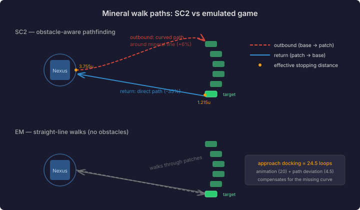

# The Minerals Were in the Way

The gas workers had the same bug. I'd fixed it there — docking overhead paid by workers who'd already been standing at the geyser entrance, waiting. Proportional absorption: subtract the wait time from the docking constant, floor at zero. The 3-worker gas rate snapped from a 25.8% deficit to within 1.6% of Liquipedia.

The mineral workers should have the same problem. At 16 workers on 8 patches, two workers per patch take turns. The second worker waits at the patch while the first mines. When it starts mining, the EM charges the full approach docking — 24.5 loops of positioning overhead on top of the 22-loop mining animation. The worker was already positioned. It just waited there.

I expected a straightforward port of the gas fix. What I got was a detour through SC2's movement physics that uncovered a gap in the entire emulated game.

## The radius fix that didn't scale

The cadence data from SC2 recordings showed that workers don't stop where the EM thinks they stop. The EM walks workers to the building edge — 1.0 units from the mineral patch centre, 2.75 units from the Nexus centre. SC2 workers stop at 1.215 and 3.755 respectively. They don't reach the building surface.

The fix seemed obvious: change the walk targets to match the observed stopping distances. The edge-to-edge walk gets 1.22 units shorter each way. Shorter walks, faster cycles, more minerals.

At 8 workers: +23.6%. The EM overproduced by nearly a quarter. I added more approach docking to compensate. The 8-worker result came back to 0% — perfect. The 12-worker result was -20%. The 16-worker result was -30%.

No single constant bridged the gap. What made 8-worker mining accurate destroyed 12-worker and 16-worker mining. The radius correction worked at one saturation and collapsed at every other.

## The radii that moved

I recorded SC2 cadence data at three saturations — 8 workers, 12 workers, 16 workers — and ran the cycle decomposition on each.

| Saturation | Mining radius | Deposit distance |
|------------|---------------|-----------------|
| 8w (1 per patch) | 1.215u | 3.755u |
| 12w (1.5 per patch) | 1.291u | 3.765u |
| 16w (2 per patch) | 1.623u | 3.559u |

The effective mining radius *increased* with saturation. At 16 workers, workers stopped 60% further from the patch centre than at 8 workers. The per-patch data was worse: individual workers ranged from 0.9 to 2.8 units, with no correlation to the patch's distance from the base. Two workers on the same patch, at the same distance, stopped at different radii.

The effective radii aren't geometry. They're a contention effect — workers competing for approach angles, navigating around each other, ending up further from the patch when the mineral line is busy. A fixed constant can't model a dynamic phenomenon.

## First principles: why was the outbound walk longer?

The cadence data had an asymmetry I'd been glossing over. The outbound walk (base to patch) averaged 3.39 units — 6% longer than the straight-line edge-to-edge distance. The return walk (patch to base) averaged 2.08 units — 35% shorter.

The return walk shortening was explained by the effective stopping distances. Workers stop further from buildings, so the walk between the two stopping positions is shorter than the edge-to-edge distance.

But the outbound walk was *longer* than straight-line. That's not a stopping-distance effect. Workers were walking a longer path on the way out than on the way back.

Why?

Because the mineral patches were in the way.



SC2 uses a unified pathfinding system. Every unit — worker, army, everything — navigates around every obstacle. Buildings, mineral patches, other units. When a worker walks from the Nexus to a far mineral patch, it paths around the near patches because they are physical obstacles. The return walk is more direct because there are no patches between the worker's mining position and the base.

The EM doesn't do this. `WorkerSimulation.moveOneLoop()` walks in a straight line toward the target. No obstacle awareness. The worker walks through mineral patches as if they aren't there.

## The gap isn't just minerals

I checked the EM's pathfinding infrastructure. There is one — a full A* pathfinder with smoothed waypoints, used by `EmulatedEngine` for army unit movement. It operates on a `TerrainGrid` that models terrain height: HIGH, LOW, RAMP, WALL.

Buildings are not in the grid. Mineral patches are not in the grid. Resources are not in the grid.

The EM's A* pathfinder navigates army units around terrain features — cliffs, ramps, map boundaries. But it has no concept of buildings or resources as obstacles. An army unit walking past an enemy base would path through its structures.

The approach docking constant — that 24.5 loops of "positioning overhead" — was compensating for an entire missing physics layer. It absorbed the fact that workers should have been walking curved paths around mineral patches but were walking straight lines instead. The path deviation formula (`PATH_DEVIATION_SCALE`, `PATH_DEVIATION_BASE`) was a per-patch approximation of what obstacle-aware pathfinding would produce naturally.

## The fix that works across saturations

The radius constants don't work because the effective radii are saturation-dependent. The pathfinding fix is the right answer but it's a large structural change. What works now is the same mechanism that fixed gas: wait-time absorption.

```java
double approachDocking = w.assignedPatch.approachDockingLoops;
if (wasWaiting) {
    double waited = currentLoop - w.waitingSinceLoop;
    approachDocking = Math.max(
        SimulatedWorker.APPROACH_ANIMATION_LOOPS,
        approachDocking - waited);
}
```

Workers that were waiting at the patch absorb the approach docking proportionally to their wait time. The floor is `APPROACH_ANIMATION_LOOPS` (20 loops) — the irreducible approach animation that even a positioned worker must play. The absorbed portion is the path deviation component: the extra time from navigating around the mineral line, which a waiting worker already traversed on arrival.

The gas fix floors at zero — gas workers enter the building directly, no approach animation needed. The mineral fix floors at 20 — the approach animation is real physics. That's the only difference.

| Baseline | Before | After |
|----------|--------|-------|
| 8w | +4.9% | +4.3% |
| 12w | -1.9% | -0.3% |
| 16w | -1.7% | -2.0% |
| 24w | -2.7% | +0.8% |

The 12-worker result — the most common worker count in real games — went from -1.9% to -0.3%. The 24-worker result swung from -2.7% to +0.8%. The max error across all saturations dropped from 4.9% to 4.3%.

## What's next

The approach docking still compensates for a missing physics layer. The right fix is a dynamic obstacle model: buildings and mineral patches registered as non-walkable cells in the terrain grid, worker mining walks routed through the same pathfinding as army units. When that lands, the approach docking shrinks to pure animation overhead, the outbound/return walk asymmetry emerges from physics instead of constants, and the per-patch path deviation formula becomes redundant.

Everything calibrated on straight-line walks — mineral approach, gas approach, deposit duration, collision model — will need a fresh calibration pass. The constants were tuned to absorb a physics gap. When the gap closes, the absorption overcompensates.

The minerals were in the way the whole time. We just weren't looking at them as obstacles.
