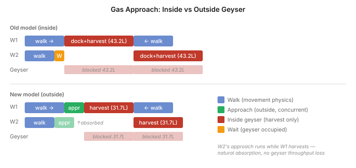

# Where Does the Gas Worker Go?

The EmulatedGame's gas income has had a shape problem since the acceleration correction landed. At close geyser distances (5u), workers produce 25% too much gas. At real map distances (7.6u), they produce 18% too little. The docking constant — 11.5 loops of overhead added inside the geyser — was calibrated against the old a=3.5, and no single constant can fix a slope.

The investigation started with an obvious question: what walk distance is the EM actually using? SC2 gas buildings are 3x3 tiles, half-footprint 1.5. The code had `GAS_BUILDING_RADIUS = 1.75` — a circular approximation that made every gas walk 0.25u shorter per leg. At close distances, that's 30% of the walk gone. At far distances, 7%. The error scales with the fraction, which is why it's distance-dependent.

Fixing the radius to 1.5 helped close distances immediately: 1w at 5u dropped from +25% to +16%. But it made far distances slightly worse. The docking constant was compensating for the too-short walk, and lengthening the walk exposed its overcorrection at longer distances.

The deeper problem turned out to be architectural. The docking animation was modeled inside the geyser — the worker enters, then spends docking + harvest time occupying the building. For a single worker, the total cycle time is the same whether docking happens inside or outside. But for three workers rotating through one geyser, inside-docking blocks the geyser for 43.2 loops per worker instead of 31.7. The geyser throughput drops, and the 3w rate falls below Liquipedia's 163 gas/min.

The fix separates approach from occupation. The approach animation now runs at the geyser door — the worker stands there for 11.5 loops before entering. The geyser itself is occupied only during the 31.7-loop harvest. For multi-worker rotation, the approach timer runs in parallel with any wait for geyser access. If a worker queues while the geyser is occupied, the approach completes during the wait — natural absorption, same as the old docking model but without blocking the building.

The result: 3w at 5u went from -3.7% to +1.6% against Liquipedia. The geyser rotation now stays near its theoretical maximum regardless of walk distance.

A code review caught a bug the original implementation missed. Four entry points — `onGasBuildingCompleted`, `rebalanceGasWorkers`, and two sync methods — set workers to `HARVESTING_GAS` without resetting `phaseEndLoop`. Workers transferred from minerals carried a stale positive value from their mining phase, which the approach timer check (`phaseEndLoop <= 0`) interpreted as "approach already started." First-trip approach animation skipped entirely. The fix was four single-line `phaseEndLoop = 0` additions.

Two smaller fixes went in alongside. `WorkerPhysicsConfigProducer` had six CDI defaults that had drifted from the `WorkerPhysicsConfig` constants — acceleration still at 3.5, deposit-duration at 12, reroute-threshold at 22. The Quarkus-deployed application was running different physics from the unit tests. And `assignToNearestPatch` was reading a mutable field for its mining-start timing instead of taking `currentLoop` as a parameter. During the tick inner loop the field happened to be in sync, but any call outside the loop — builder returns, scout returns, gas reassignment — used the tick start time, up to 22 loops early.

The 1w shape mismatch persists: +16% at 5u, -21% at 7.6u. The trapezoidal velocity profile is correct (a=4.9 from the per-loop profiler), and no single constant overhead can fix a slope. What's missing is understanding how SC2 workers actually approach gas buildings — whether there's a deceleration animation, an entry overhead that scales with distance, or something else the flat walk model doesn't capture. Per-tick position recording from SC2 would answer it.
